<div align="center">


**从一个考研想法，到一份有依据、可解释的选择清单。**


[实际界面](#从一句想法开始) · [算法怎么工作](#让取舍可以解释也可以复算) · [数据如何流转](#从搜索到建议中间发生了什么) · [知识库](#越研究越有积累但不是搜到就收) · [本地运行](#在自己的电脑上运行) · [开发接手](#让下一个开发者快速接手)

</div>

研序 AI 是面向全国考研择校规划的研究 Agent。你可以从“想考计算机”“已经准备这些科目”“希望留在某个地区”开始，由 AI 梳理研究路径、元宝搜索发现官方材料，再结合原文核验与确定性算法比较选择。

它把散落在研究生院、学院目录、考试通知里的信息组织起来，也把**为什么推荐、需要改几门、依据在哪里、什么还没确认**留在界面上。当前围绕 **2028 年入学规划**，使用 **2027 年参考资料**。

## 从一句想法开始

> 我想考计算机，希望留在天津。能根据我已经准备的科目，帮我看看有哪些选择吗？

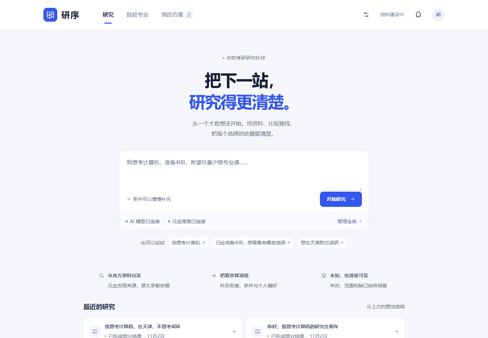

| 你关心什么 | 系统如何协助 |
| --- | --- |
| 想法还不够具体 | 理解目标，提出少量关键问题；识别出的条件先确认，再参与计算 |
| 想知道多准备一门能多哪些选择 | 比较 0 / 1 / 2 个考试单元调整，列出新增与保留的方向 |
| 官方公告太多，担心漏信息 | 元宝发现来源，Agent 按需读取官方原文，保留查询与工具执行记录 |
| 一条结论能不能相信 | 查看真实年份、原句、官方链接、页码或结构化字段路径 |
| 下次还得重新查一遍 | 通过质量准入的资料进入知识库，后续研究优先检索复用 |
| 想调整建议 | 补充条件或修改偏好，明确停止与继续；原有成果保留，新一轮独立核算 |

### 一个持续可调整的研究工作台

输入框始终容易找到。运行中可以补充草稿，完整日志按轮次收起，候选按学校组织；来源、算法与方法分开查看。中文组词、选区和撤销记录不会被后台进度刷新打断。

下面是本机已有真实研究的来源页：展示实际取得的材料与状态，不用聊天文字冒充官方事实。

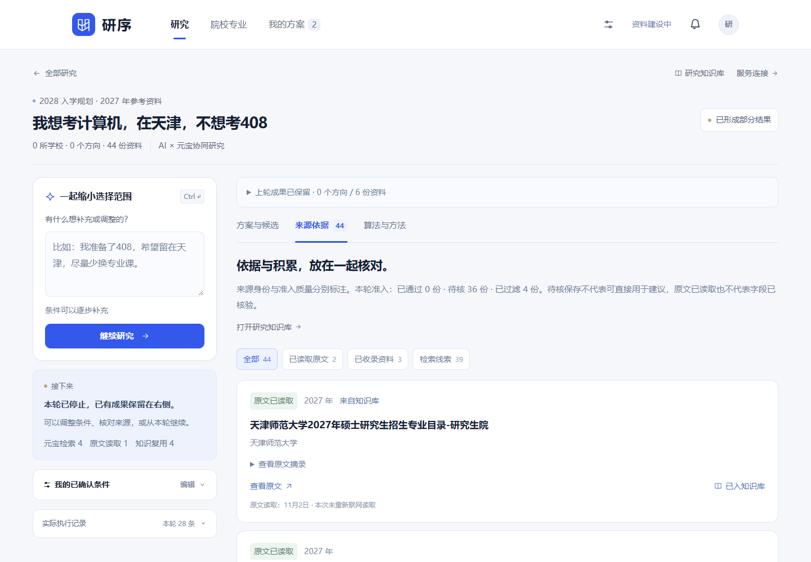

## 让取舍可以解释，也可以复算

AI 负责理解、规划和归纳；**比较结果由程序计算**。核心实现位于 [grad_engine.py](grad_engine.py) 与 [planning_engine.py](planning_engine.py)。

| 算法 | 解决的问题 | 具体做法 |
| --- | --- | --- |
| **条件树与三态规则** | 我到底符合哪些条件？ | 逐项计算 `matched / excluded / unknown`，支持组合条件；缺学历、资格或证据时保持待确认 |
| **有作用域的科目距离** | 已准备的科目能否衔接？ | 按考试单元比较“代码 + 命题范围”，保留合法备选组；不同学校同号自命题不直接等价 |
| **独立科目排除** | 不考408，还能保留哪些选择？ | 排除意愿与备考事实分开；保留有依据的合法替代科目，再重新计算换科；身份或套组不明确时保持待核 |
| **可解释偏好排序** | 少换科目和低费用怎么取舍？ | 对已知分项归一化、加权，并返回排序依据；缺失分项保留区间，不当作零 |
| **Pareto 前沿** | 有没有各方面都更合适的候选？ | 对条件通过且分项完整的候选计算非支配集合；采用排序与 Fenwick 前缀最大值，避免逐对扫描 |
| **0 / 1 / 2 单元路线** | 改一点备考方案会怎样？ | 仅调整允许改变的考试单元数，保留其他已确认条件，比较方向覆盖与增减 |
| **最小条件调整** | 最少放宽什么才有新选择？ | 只枚举用户允许的地区、年费及换科上限，最多 128 个组合，优先最少变更字段并去重 |

科目衔接的基本判断是：**同一考试单元内，合法选项是否存在相同身份的科目**。科目身份、考试单元或准备信息不完整时返回不可确定，不猜成“零换科”。“只去天津”是硬条件，“优先天津”是软偏好；地区偏好仅在启用相应权重时参与综合排序，不覆盖费用优先或科目优先的主要依据。偏好分不是录取概率。

候选查询在已发布资料的指定学校、年度和关键词范围内先筛选、粗排，再精选最多12个方向；不会只看最前面的12条。超时、停止或发布版本切换时保留已取得成果，明确区分“总数尚未知”和“扫描未完成”。这不代表全国招生资料已经收齐。

### 把“多准备一步”带来的变化画出来

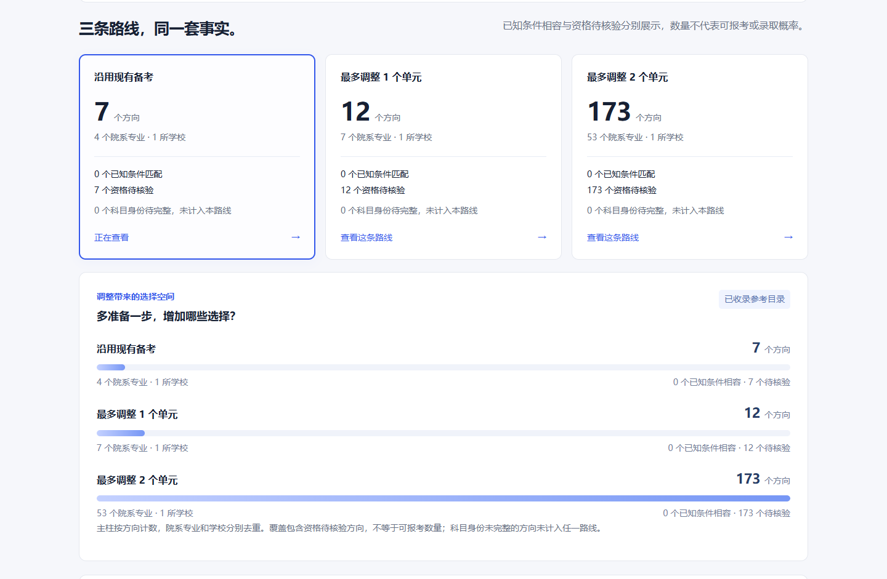

这张图来自真实本地算法：以本科、全日制、准备 `101 / 201 / 301 / 408`、南开大学 2027 年参考目录为演示条件，三条路线分别覆盖 **7 / 12 / 173 个方向**。这三组方向的资格均仍待核验，已确认资格匹配数均为 0；方向覆盖数不能当作可报名人数或录取率。

## 从搜索到建议，中间发生了什么

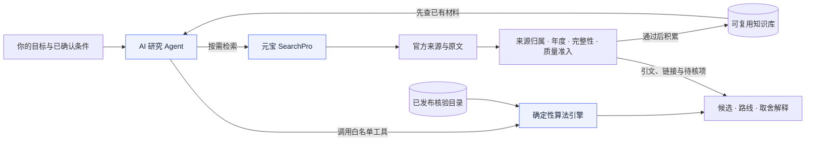

**两条数据通路，承担不同职责：**

- **研究通路**：元宝发现链接 → 读取允许的官方原文 → 保存 SHA、真实年份和取得状态 → 质量准入 → 可复用资料或待核线索 → 报告引用。
- **正式目录通路**：原文留档 → 专用解析适配器 → 字段依据与冲突检查 → 必要的 PDF 语义审校 → 显式离线发布 → SQLite 查询版本 → 算法计算。

新网页与模型抽取不会直接写回正式招生库。研究发现可以先形成有出处的材料，结构化字段仍走自己的核验与发布流程。

### 五份真实领域 Skill

Skill 是随研究加载的领域规程文件，工具是实际执行入口。页面区分“未加载、已加载、关联工具已执行”，不会把加载文件等同于完成任务。

| Skill | 负责的判断 |
| --- | --- |
| [理解需求](skills/understand-intent/SKILL.md) | 识别目标、年份与条件，避免把推测当作用户确认 |
| [研究官方资料](skills/research-official-sources/SKILL.md) | 复用知识、安排有限检索、确认学校身份与来源范围 |
| [核对原文依据](skills/verify-evidence/SKILL.md) | 分清摘要、原文和字段事实，检查年度、作用域与冲突 |
| [比较备考方案](skills/compare-plans/SKILL.md) | 调用实际算法，解释科目、预算与条件调整 |
| [复试与调剂研究](skills/assess-transfer-options/SKILL.md) | 按任务需要加载，区分历史相容性与当年真实缺额 |

## 越研究，越有积累，但不是搜到就收

知识库保存可追溯的来源记忆。**取得状态**与**准入质量**是两个维度：读到了原文，不代表已经适合复用；通过准入，也不代表每个报考字段都已核准。

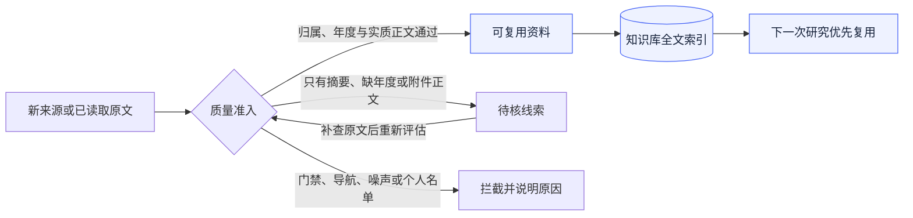

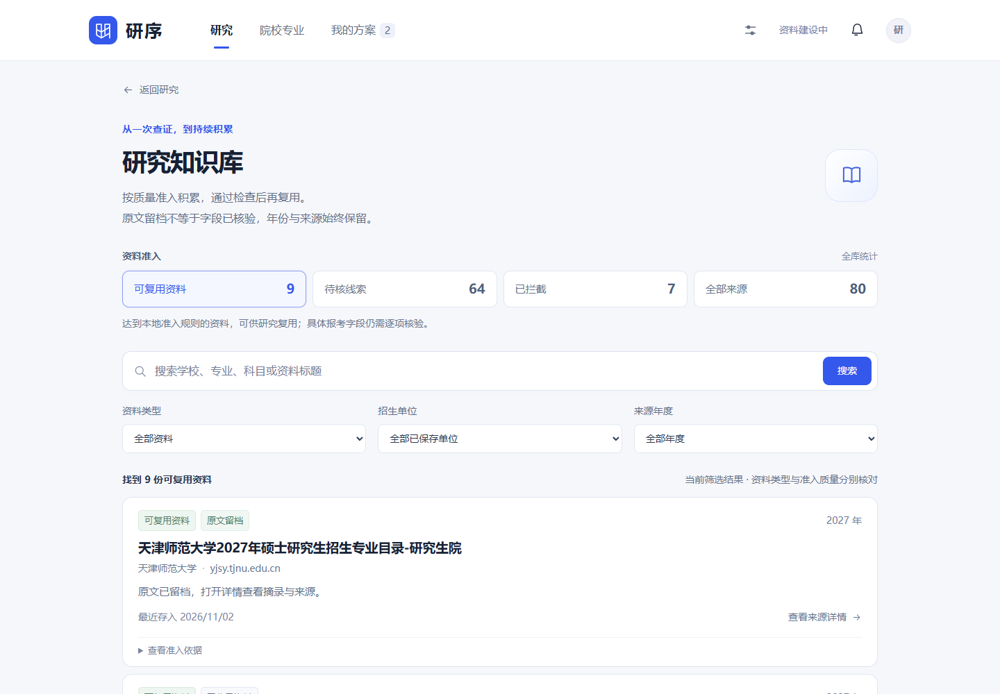

| 分区 | 怎样进入 | Agent 如何使用 |
| --- | --- | --- |
| **可复用资料** | 官方归属可核、适用年度明确、正文有对应招生信息；原文留档通过完整性检查 | 默认列表与 `search_knowledge` 只复用这一类，并再次检查年份和原文状态 |
| **待核线索** | 搜索摘要、归属或年份不明、只有附件发布入口等 | 单独查看与补证，不计作可信知识命中 |
| **已拦截** | 门禁、纯导航、脚本样式噪声、明显无关或个人名单 | 新内容不进入知识库；已有记录保留审计，页面不展示拦截正文 |

每条资料都能展开准入原因。规则检查正文里的实质信息，不把标题年份当学制、邮编当专业代码，也不靠字数决定质量；很短的官方科目变更同样可以有价值。

### 长文精读、版本维护与真实问题评测

- **从命中走回原文。** 文档按章节、段落和表格行分段，保留提取版本、真实 PDF 页码和 Unicode 字符位置；跨页表头单独引用，可以继续读前后条款。
- **关键词分散也能定位。** 优先要求同片段命中全部关键词；没有结果时，先确认全部词存在于同一份当前原文，再按词覆盖数定位片段。分散命中会明确提示，不能拼成联合事实。
- **维护不靠改质量标签。** 准入质量、有效性、提取完整性和本地索引状态分别记录。撤信、冲突或被替代的资料停止可信复用，历史报告也重新检查来源。
- **重建保留审计。** 原文件按 SHA 留档；旧摘要不能冒充全文。显式重建可从仍可校验的留档原件离线提取，失败保留旧可用代次和失败任务，支持重试。

已冻结 **34 道真实问题、29 份官方原件、17 所学校** 的评测集。固定关键词与读取预算下，31 道适用题均命中目标来源，29 道读齐全部必要引文；3 道年度或发布链挑战单独保留。详见 [可复现评测与边界](docs/KNOWLEDGE_EVALUATION.md)。这验证本地资料通路，不代表模型回答准确率或全国资料覆盖率；Embedding 与 Milvus 属于下一节点。

<details>
<summary><b>查看真实拦截原因、去重与版本规则</b></summary>

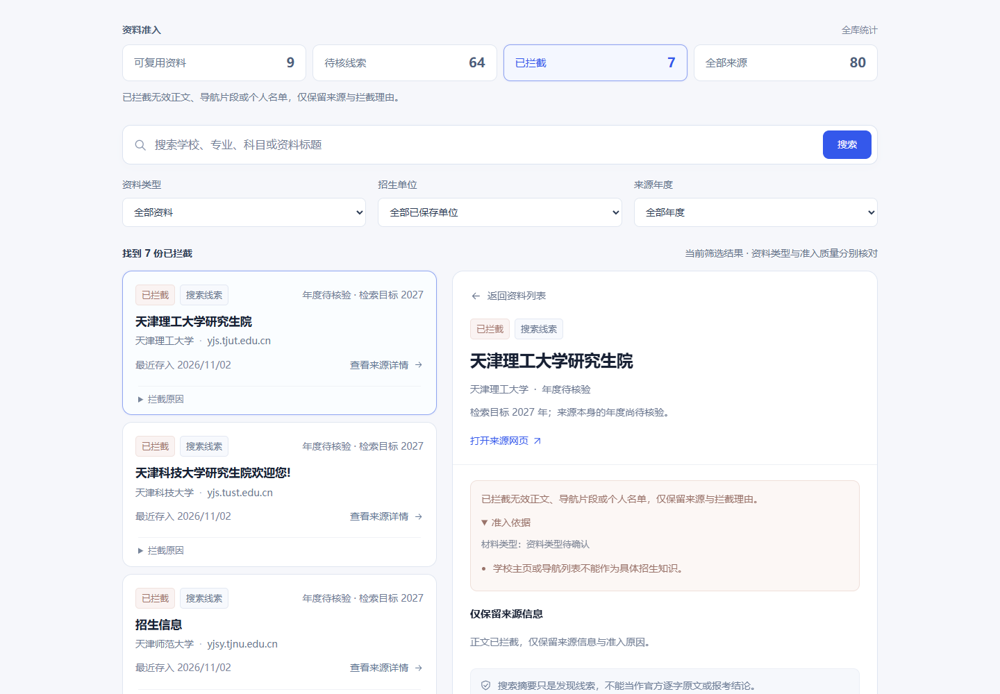

- 按来源、招生单位与内容版本合并引用；同一 SHA 的材料不冒充多份独立印证。
- 保存真实年份与原读取日期，缓存命中不冒充本次刚联网核验。
- 原文缺失或 SHA 改变后撤销复用资格，隐藏旧正文。
- 弱摘要命中已有强记录时，复用强记录的真实正文与日期，不给新摘要贴旧认证。
- 私人对话、学生档案和服务密钥不进入知识库；写库故障与正常规则拦截分别提示。

本机截图拍摄时已有 **80 条来源：9 条可复用、64 条待核、7 条拦截**。这些个人研究运行记录不随仓库分发，首次启动的知识库为空，会随着自己的研究逐步积累。

</details>

## 让数字和原文始终在一起

字段依据可以展示原句、页码或字段路径、官方链接、真实年度与适用范围。多份材料按同源和版本组织，存在冲突时暂停采用确定值。

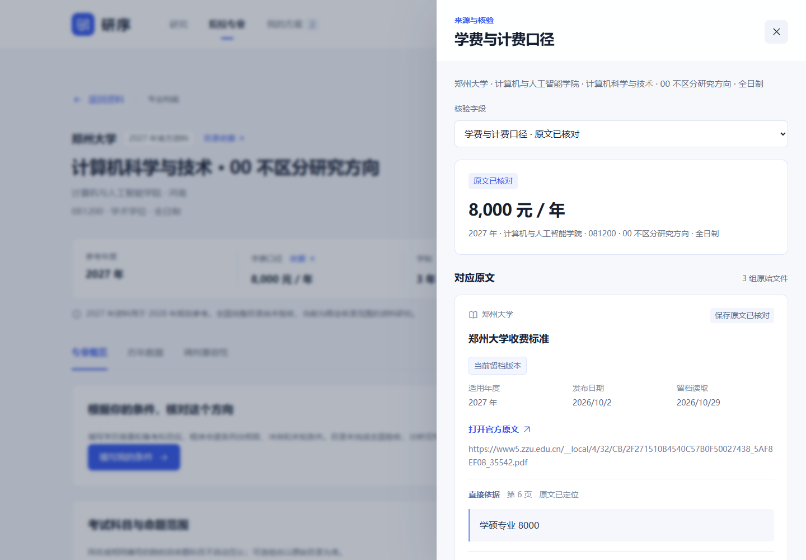

<details>
<summary><b>展开院校目录、历史图与移动端界面</b></summary>

### 院校与专业目录

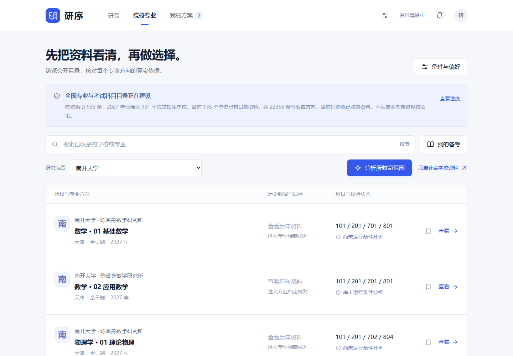

### 历史分数按年份与口径分开

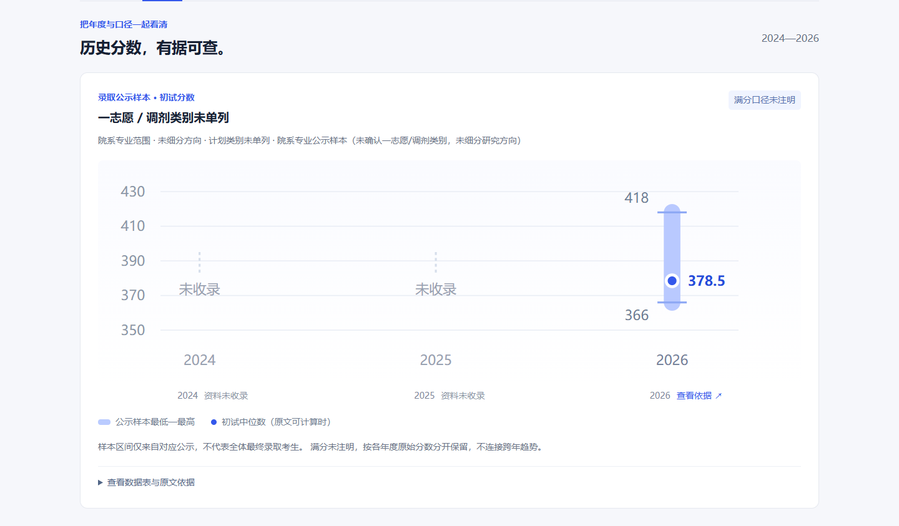

图中展示本机已有原文支持的 **2026 年录取公示样本初试区间 366—418、中位数 378.5**；2024、2025 年缺失，明确留空。学校参考线、专业线、录取初试和复试成绩分别处理，不连成虚假的完整趋势。

公开数据包排除逐人录取原文及其依赖的录取聚合样本；上图不能作为新克隆后默认具有这些样本的承诺。公开包保留可核原文的学校参考线，完整数据范围见 [数据包说明](data/README.md)。

### 手机也能查依据

<p align="center"></p>

</details>

## 接入你选择的 AI，与元宝协同研究

内置 **16 个接入选项**，覆盖常用模型厂商、本地 Ollama 与自定义兼容接口。选择服务商、读取或填写模型、测试并保存；**模型列表可见与生成测试成功分开呈现**。

<table>
<tr>
<td width="50%"><b>AI 模型：理解与规划</b><br>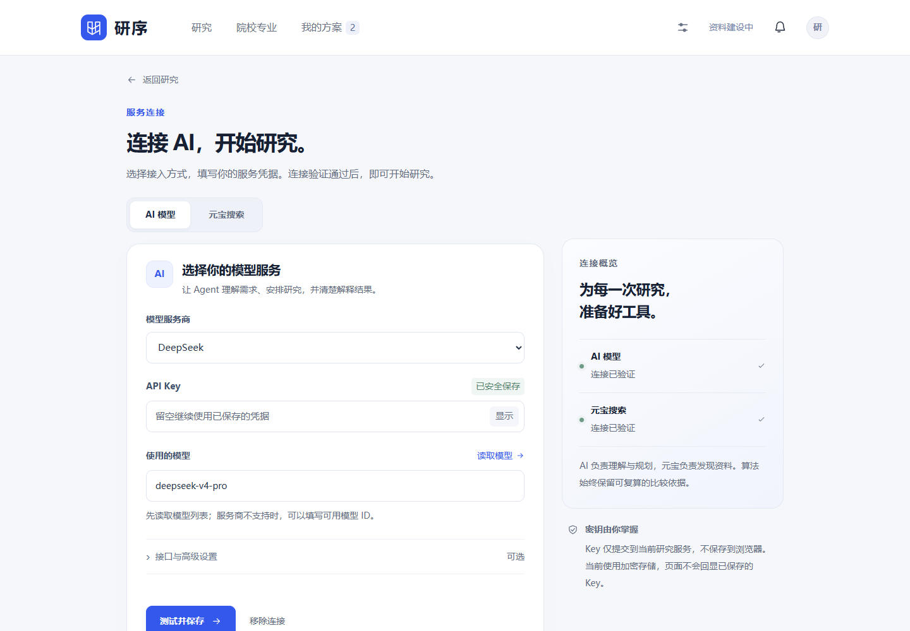</td>
<td width="50%"><b>元宝搜索：发现官方材料</b><br>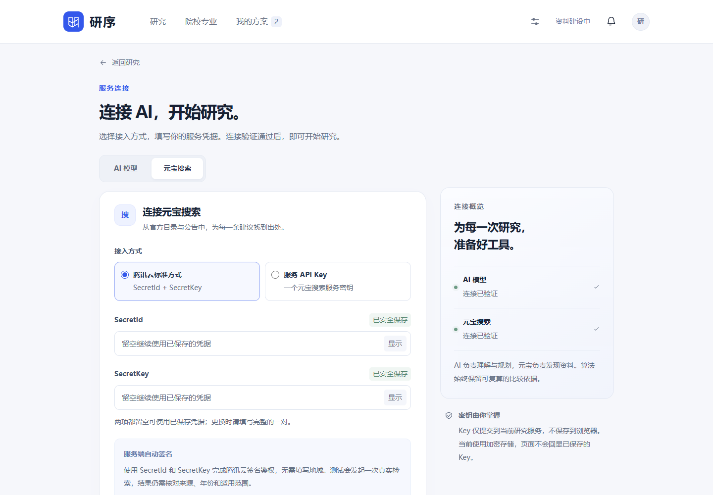</td>
</tr>
</table>

元宝支持两种方式：**腾讯云标准鉴权 `SecretId + SecretKey`**，以及**服务 API Key**。AI 与搜索独立配置、验证和保存；Key 只在本项目服务端使用，不进入 URL、浏览器持久化存储或 Git 仓库。Windows 使用当前账户 DPAPI 加密，非 Windows 当前为会话存储。

截图中的连接状态来自本机当时已保存的真实配置，输入框不回显凭据。仓库不携带这些配置；新克隆需要使用自己的服务凭据。读取目录和本地确定性算法不需要 Key，真实模型与搜索调用按所用服务计费。

## 在自己的电脑上运行

**环境：Python 3.11+；首次发布还需配置两套 PDF 提取入口。** 本资料包的逐字引文使用 PATH 中的 Xpdf `pdftotext 4.00`，表格坐标使用 `GRAD_PDFTOTEXT` 指向的 Poppler `26.07.0`（相邻目录含 `pdftocairo`）。请先按 [运行说明](docs/RUNNING.md) 核对版本；不要将现代 Poppler 目录加入 PATH 替换原文引擎。Windows 建议克隆到较短路径，避免旧提取器的长路径限制。前端为原生 ES Modules，无需构建；Node.js 仅用于前端测试和截图工具。

```bash
git clone https://github.com/xiaosongxiaosong1111/yanxu-ai.git
cd yanxu-ai

# 建议先创建并启用 Python 虚拟环境
python -m pip install -r requirements.txt

# 离线恢复随仓库提供的安全数据包；先校验 SHA，不覆盖不同内容
python tools/prepare_data.py

# 按运行说明配置并检查两个 PDF 工具后，再重放为本机查询版本；首次需要数分钟
python -X utf8 -m collectors.publish_catalog --data-dir data

python -X utf8 server.py --port 4180
```

打开 **[http://127.0.0.1:4180/](http://127.0.0.1:4180/)**。安装 Poppler、路径配置、隔离依赖和更多命令见 [运行说明](docs/RUNNING.md)。

1. 不配置 Key，也可以先浏览已发布目录、核对字段原文、使用本地算法。
2. 在「服务连接」配置自己的 AI 与元宝，测试并保存后开始研究。
3. 用自己的备考条件确认方案，查看算法解释与来源；研究资料按准入规则持续积累。

### 资料随代码怎样交付

仓库提供经过筛选的**压缩数据包 + 文件 SHA 清单 + 离线恢复工具**，避免将大型展开文件、本机数据库和全部采集缓存直接提交。当前已采用目录为 **135 个单位、22,356 条真实专业或方向**；2027 年度名单为 **931 个独立硕士招生单位**，通用索引保留 936 条。未采集或未核验的单位和字段继续标明状态。

压缩包保留运行所需的公开目录、单位年度资料、费用学制及安全原文；不包含 API Key、私人研究任务、逐人录取名单和本机动态知识库。全国官方来源可按需检索；已采用目录、历史统计和字段依据的覆盖情况逐项保留。 详细范围和恢复校验见 [data/README.md](data/README.md)。

## 让下一个开发者快速接手

| 入口 | 读完可以做什么 |
| --- | --- |
| [需求文档](docs/REQUIREMENTS.md) | 理解目标用户、功能、交互、数据准入、验收标准与后续优先级 |
| [Agent 与知识系统升级任务表](docs/AGENT_ROADMAP.md) | 查看待开发任务、实施依赖和阶段验收；与当前已实现能力分开阅读 |
| [Claude 实施与 Codex 验收节点](docs/CLAUDE_WORK_NODES.md) | 七个执行节点、交付报告和逐节点检查；Milvus 为待验证接入方向 |
| [项目介绍与 AI 接手地图](docs/PROJECT_OVERVIEW.md) | 了解模块职责、调用链、存储、API、算法入口及改动顺序 |
| [运行说明](docs/RUNNING.md) | 安装、数据恢复与发布、配置、开发和测试 |
| [Agent 实现契约](docs/AGENT_UPGRADE_PLAN.md) | 工具白名单、任务轮次、条件确认、Skill、预算和取消语义 |
| [实际验证记录](docs/VERIFICATION.md) | 区分本地原文、算法、接口夹具与真实服务调用的验证范围 |
| [封面与生成记录](docs/assets/cover-prompt.md) | 复用视觉方向、当前文案与实际图像生成提示词 |

```text
yanxu-ai/
├─ static/                 原生前端：研究、目录、方案、设置与知识库
├─ research_service.py     Agent 循环、轮次、预算、取消与继续
├─ research_tools.py       白名单工具、真实结果账本与算法调用
├─ grad_engine.py          三态条件、科目衔接、偏好与 Pareto
├─ planning_engine.py      换科路线与最小条件调整
├─ knowledge_store.py      独立知识库、全文检索、版本与原文完整性
├─ knowledge_quality.py    可解释质量准入
├─ collectors/             官方资料解析、适配、语义核验与发布
├─ skills/                 五份领域研究规程
├─ knowledge/              静态规则与官方入口索引
├─ data/bundles/           可校验的公开安全数据包
├─ tools/prepare_data.py   纯标准库离线恢复
├─ tests/                  Python / Node / 浏览器回归
└─ docs/                   需求、项目地图、运行说明与真实截图
```

公开包最初交付已在全新检出中离线恢复资料、重建 22,356 条目录，并通过 7 项 HTTP / 原文 / 算法检查。后续 N3 升级整库运行 Python **1,602 项，0 失败、3 项因环境或分发资料缺失跳过**，前端 **188 项全部通过**；14 个相关后端模块含分支综合覆盖率 **93%**。知识精读浏览器另通过 10 条模拟 API 流程，真实模型与元宝联调未重放。完整范围见 [实际验证记录](docs/VERIFICATION.md) 与 [N3 验收](docs/work_nodes/03-knowledge-workbench.md)。

核心算法与知识库回归可以独立运行：

```bash
python -m pip install -r requirements-dev.txt
python -X utf8 -m unittest tests.test_engine tests.test_planning_engine tests.test_knowledge_quality tests.test_knowledge_store tests.test_data_bundle
node --test tests/*.test.mjs
```

浏览器截图使用 Playwright；可按 [运行说明](docs/RUNNING.md) 准备环境，再运行 `node tools/capture_readme.cjs`。重拍需要本机已有真实研究、非空知识库及对应历史原文；脚本不会自动发起付费研究或填造截图数据，首次克隆不默认具有这些个人运行状态。完整原文开发留档的全量测试，与公开数据包的干净安装验收分别记录，不把缺少个人留档的环境假称为完整研究环境。

---

当前提供个人本机研究服务，默认监听 `127.0.0.1`。公开多人账户隔离、全国历史录取统计与当年调剂缺额持续核验仍属于后续工作；历史相容性和偏好排序不承诺报考资格或录取结果。
