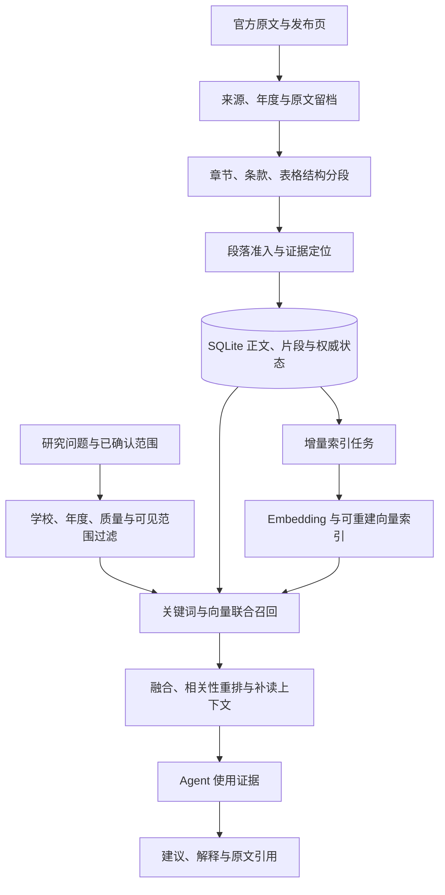
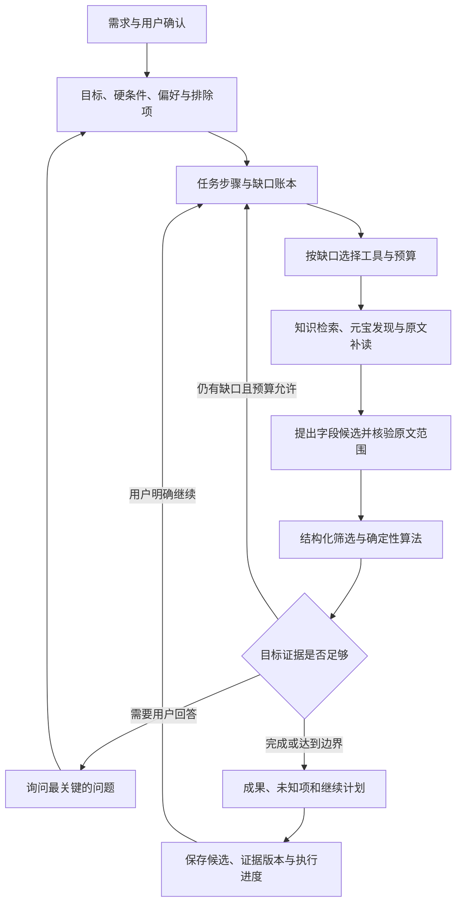

# 研序 AI · Agent 与知识系统升级任务表

> 更新：2026-11-03。状态：节点1、2保留；节点3已完成 K1文字/Office支持基础、K2结构精读、K5本地治理基础和34题真实金标的代码验收。OCR、向量索引、缺口驱动规划及新字段进入推荐仍属后续节点。产品约束见 [需求文档](REQUIREMENTS.md)，现有接口见 [Agent 实现契约](AGENT_UPGRADE_PLAN.md)。

实施分为七个节点，见 [协作节点与检查门槛](CLAUDE_WORK_NODES.md)。通常由本机 Claude 实施、Codex 验收；节点1、3因上游实施请求失败，经用户明确授权改由 Codex 实施并安排独立复查。

## 1. 本轮要达到的结果

用户可以从宽泛需求开始，Agent 能维护已确认条件、识别资料缺口、选择合适工具、复用知识、补读原文、调用算法，并在调整条件后增量更新结果。每条招生事实和推荐理由能够回到真实年度、适用范围及原文位置。

验收主场景：

> “我想考计算机，希望在天津，明确不考 408。帮我找合适方向，解释备考代价和需要核实的条件。”

用户确认条件后，Agent 应先在可用资料范围筛选，复用合格知识，按缺口查官网，得到有依据的候选；用户只改预算时，优先本地重算。遇到缺资料、来源冲突或预算耗尽，保留成果并说明下一步。

## 2. 当前基线与既定边界

| 方面 | 当前实际能力 | 下一阶段缺口 |
| --- | --- | --- |
| Agent | 真实模型—工具循环、预算、取消、继续、过程记录 | 逐目标计划、缺口判断、完成检查、增量执行记忆 |
| Skill | 五份真实领域规程，记录加载与关联工具执行 | 输入、产物、完成条件和失败策略的运行时检查 |
| 来源知识库 | SQLite、完整有界提取版本、结构片段、精确补读、有效状态及本地重建任务 | OCR、Embedding、向量与混合召回、重排及发布链年度传递 |
| 推荐 | 已发布目录、三态条件、科目距离、偏好排序、Pareto、路线试算 | 独立排除条件、全范围先筛后精选、新来源事实接入 |
| 多轮研究 | 保存旧报告、原始需求和补充条件 | 继承候选、证据版本、已完成步骤及剩余缺口 |
| 知识界面 | 检索分区、片段精读/邻接、原文定位、撤信/版本采用和索引重试 | 字段补证、版本正文差异、资料与正式推荐的完整关联 |

本阶段继续面向 2028 入学规划，以真实年度资料作为参考。全国可检索、已有结构化目录覆盖、资格核准和当年调剂缺额分别记录。历史回溯沿用最近三个已完成招生年度的需求，逐条显示真实年份和统计口径。

## 3. 架构方向

### 3.1 知识通路

- 近期保留 SQLite 管理来源、片段、质量、版本和引用；向量索引作为派生数据，可从正文和原文重建。
- 向量后端以 Milvus 为优先验证方向，Lite 与 Standalone 的具体运行模式在节点4兼容性检查后确定。当前尚未安装或接入，也未决定迁移关系数据库。
- 学校、年度、质量、可见范围属于准入条件；向量相似度不能改变它们。失效资料即使残留在索引中，也必须在返回前被阻止复用。
- 结构切分优先保护表头、专业作用域、否定和例外；较长自然段再评估 Embedding 辅助语义切分。切分参数用真实问题评测确定。
- 索引缓存身份包含文本 SHA、切分版本、Embedding 模型版本及维度。查询与资料使用兼容的模型和索引代次。
- 多人服务目标明确后，再评估关系数据库迁移和 Milvus 部署规模；目前保留 SQLite 的权威状态。用户隔离仍需单独实现。

### 3.2 Agent 工作通路

计划由模型协助提出，工具权限、参数校验、事实采用、预算和状态转换由程序约束。模型停止调用工具、Skill 加载成功或 HTTP 200 均不能单独作为目标完成的依据。

## 4. 开发任务表

B1、I1和R1已有目录筛选部分已完成代码验收；B0已冻结34题真实证据并可离线复测。K1文字/Office基础、K2、K5本地治理和U2精读维护子集在N3完成；OCR、向量联调、动态补证和R1新来源字段接入尚未完成。P0是正确性与效果基线；P1是核心能力。实际结果见 [节点1](work_nodes/01-foundation.md#节点1验收记录2026-11-03)、[节点2](work_nodes/02-intent-selection.md#节点2验收记录2026-11-03)、[节点3](work_nodes/03-knowledge-workbench.md)。

| ID | 优先级 | 任务与交付内容 | 前置依赖 | 核心验收 |
| --- | --- | --- | --- | --- |
| B0 | P0 | 建立首批 30—50 个真实问题及证据金标，记录当前效果 | 无 | 每题有应命中的原文、年度、作用域、允许结论或应保持未知的原因；能重复跑出基线 |
| B1 | P0 | 修学校/年度后过滤导致的漏召回、动态 PDF 年度、分数表实质内容识别 | B0 | 他年 48 条或他校 8 条之前置干扰不再挤掉目标资料；PDF 年度有原文定位；规范数字表不会仅因缺“分”字误判 |
| I1 | P0 | 统一目标、硬条件、软偏好、排除项和未知项；绑定用户原句与确认状态 | B0 | “不考408”可独立执行；与已有条件矛盾时澄清；不擅自填其他科目、学历或地区 |
| K1 | P1 | 建立文档/版本/提取层，改善正文、章节和表格解析；分批补附件与 OCR | B1 | HTML/文字 PDF 先通过；Excel/Word、扫描 PDF 各有支持状态与样例；OCR 稿能回到原页，低可信内容保持待核 |
| K2 | P1 | 结构化分段，保存页码/章节/表格关系/原文位置；提供片段与邻接上下文补读工具 | K1 | 长文后半段及第20页后的关键条款可找到、可补读；否定和例外完整；每段可打开官方出处 |
| K5 | P1 | 知识有效版本、替代/冲突/撤信、待索引任务、失败状态与幂等重试契约 | K2 | 原文失效或撤信后不可再可信命中；任务失败不冒充完成；旧版留审计、不重复当独立印证；重建所需正文与状态完整 |
| K3 | P1 | Embedding 独立配置与测试、模型/维度/切分版本记录、增量向量化和一种可重建向量索引 | K2、K5 的状态与任务契约 | 聊天连接不冒充 Embedding 成功；同内容不重复计费；换模型建新代次再切换，可回退；索引丢失可由来源和片段重建 |
| K4 | P1 | 范围过滤前置，关键词与向量联合召回、融合去重、相关性重排和补读 | K3、K5 最小版 | “跨考/跨专业”能命中正确条款；301/302和自命题范围仍精确处理；对比 B0 的召回、延迟与成本 |
| A1 | P1 | 任务步骤与缺口账本，明确每个目标的必要事实、已有证据、下一动作和完成条件 | I1、B0 | 能区分完成、待回答、待补证、预算结束；模型说完成但证据不足时不标为已完成 |
| A2 | P1 | 把五份 Skill 补成可检查执行契约：输入、工具、产物、检查、失败和停止策略 | A1、K2 | “核对依据”须有学校/年度/范围/真实位置；记录加载、执行、通过检查三个独立状态 |
| A3 | P1 | 按缺口规划查询、选择工具、分配预算与重规划；在必要时提出少量关键问题 | A1、A2、K4 | 缺学费优先查收费条款；已有证据够用就计算；连续失败换合法来源或报告缺口；预算用尽保留继续计划 |
| A4 | P1 | 多轮增量研究、候选与证据版本继承、依赖失效和幂等步骤 | A1、K5；与 A3 联调 | 只改预算可本地重算、无必要的新搜索；改地区只更新受影响范围；重启不自动续跑付费调用 |
| F1 | P1 | 原文片段 → 字段候选 → 作用域与引用验证 → 可计算临时候选 | K2、K5、I1 | 新取得的合格目录可贡献真实候选；冲突值暂停；缺资格仍 unknown；模型文本不直接覆盖正式目录 |
| R1 | P0/P1 | 已收录范围先硬筛和粗排，再选择少量候选深查；接入新事实，保留路线、取舍及有证据的复试/调剂规则匹配 | I1；新候选部分依赖 F1 | 后续合适方向不会因前12项占满而失去计算机会；解释入围/排除原因；未知费用不当免费，未知资格不当符合；历史调剂衔接不冒充当年有缺额 |
| U1 | P1 | 研究页围绕目标、已确认条件、关键缺口、候选取舍及本轮变化组织 | A1、R1；与 A3/A4 联调 | 能改条件、回答关键问题、看为何调用工具；一条建议可回到对应证据；保留现有 IME、取消和草稿保护 |
| U2 | P1 | 知识维护与阅读：命中段定位、补原文/年度/附件、版本差异、事实和建议关联 | K2、K5 | 待核原因对应具体补证动作；补证后重新检查；不提供无依据的“一键变可信” |
| E1 | P1 | 真实服务闭环、离线效果对比、端到端回归、调用与索引成本记录 | 分阶段执行；最终依赖全部核心项 | 在约定模型/预算下跑真实案例；夹具、离线和真实调用分开；完整展示搜索、原文、算法、引用与失败恢复 |

K5 先交付有效版本、撤信过滤、待索引和失败状态；K3 使用这些状态接入向量后端并实现完整重建，随后联调。依赖方向为 K2 → K5 → K3 → K4，K5 不依赖 K3 才能开工。

R1 可拆为两次交付：I1 后先改善已有目录的筛选顺序；F1 后再接入新来源产生的可计算候选。K1 的附件/OCR 也按资料类型分批验收，不能用缺正文的发布页冒充已解析附件。

## 5. 实施批次和里程碑

| 批次 | 任务 | 用户可观察到的变化 |
| --- | --- | --- |
| 第一批：正确性 | B0、B1、I1，R1 的现有目录筛选 | 已有资料找得到；“不考408”确认后生效；相同问题有可比较的评测基线 |
| 第二批：能读关键证据 | K1、K2，启动 K5 与 A1 | 能读长文关键条款和完整表格关系；Agent 能说明已知、缺什么、下一步 |
| 第三批：语义检索 | K3、K4、K5 最小可靠版；A2 并行 | 自然语言能找到正确片段；精确科目约束保留；索引失败与撤信有真实状态 |
| 第四批：智能决策 | A3、A4、F1、R1 完整版 | 按缺口研究；新增证据能贡献候选；修改条件增量更新，减少重复调用 |
| 第五批：交互与实测 | U1、U2、E1，补齐 K5 | 建议可解释可追溯，知识可维护，真实案例的效果和成本可验收 |

前端交互随相应能力分批接入，不等到最后统一堆按钮。已有冷白、炭黑、钴蓝的视觉方向保留，主要改善信息顺序和操作目的。

第一批完成后先复测，再开始下一批。基线建设、Agent 任务账本与原文分段可以按模块边界并行；向量索引上线必须伴随最小撤信与失败治理。

## 6. 效果评测与完成标准

### 6.1 首批问题的必测类型

| 场景 | 预期检查 |
| --- | --- |
| “天津、计算机、不考408” | 原句识别、确认、排除条件和候选计算一致 |
| “想考计算机，还没定科目” | 先给可研究方向，再问影响最大的少量问题，不补默认科目 |
| “明年入学”及下一年度目录未发布 | 澄清年份，历史参考资料保留实际年度 |
| “是否接受跨专业，部分方向例外” | 同时找到主规则、例外与专业范围 |
| 分数表只有表头和数字 | 识别表格关系，不靠数字后必须有“分”判断价值 |
| 关键条款超过第20页或位于长文后半段 | 命中并补读对应段落，无开头截取依赖 |
| 同一公告被更正或多链接转载 | 识别同源与替代关系，不把旧版和转载当独立印证 |
| 用户只修改预算 | 可本地重算；没有必要的新搜索、原文读取或整库向量化 |
| 新发现专业不在旧目录；资格章程缺失 | 可审校目录字段进入临时候选，资格继续 unknown |
| “一志愿没录取，所考专业课有哪些调剂衔接” | 分别核对学科、科目和适用年度的官方规则；历史相容与当年缺额分别呈现，资料不足不保证能调剂 |
| 存在门禁、撤信、索引失败、取消或重启 | 清楚呈现边界，保留成果，不伪造读取/建库成功，不自动恢复付费调用 |

### 6.2 指标和门槛

- 记录正确证据片段 Recall@5、首次正确片段排名及引用位置正确情况；金标同时标注必须一起读取的主规则与例外。
- 记录学校/年度串用、无依据结论、硬约束违反，以及未知被误当符合的情况。必测用例出现这类错误时，当前批次不能标记通过。
- 记录待核原因、有效原文比例、重复来源与过期版本；收录数量增长不能代替有效知识增长。
- 记录模型/元宝/原文读取次数、增量 Embedding 次数、延迟与服务返回用量；费用按实际服务计价核算，次数与 token 预算不冒充金额上限。
- 记录只改偏好时重复外部调用次数。可由已验证本地数据完成的重算，不应重新联网。
- 数值提升目标在 B0 基线后确定；拆分开发集与保留集，避免只对演示问题调参。没有实际结果前不填写“准确率95%”或宣称完整全国推荐。

E1 的真实调用必须明确使用哪种服务、哪些公开问题和调用预算；只使用本项目授权配置，不复制其他应用凭据。测试夹具可用于回归，但不能作为真实元宝和模型闭环的完成依据。

## 7. 数据契约和模块落点

以下为拟新增或扩展的概念，具体表名和 API 在实现前确定，不代表已有接口。

| 概念 | 至少保留的信息 |
| --- | --- |
| 文档版本 | 官方 URL、学校、年度证据、读取时间、原文 SHA、当前有效/替代/撤回状态 |
| 知识片段 | 文档版本、章节、页码/位置、表头与行关系、原文文本、提取器版本、文本 SHA、切分版本和质量；提取/OCR稿与原文件分开标识 |
| 索引记录 | 片段 ID、文本 SHA、Embedding 服务/模型/版本/维度、索引代次、任务和失败状态 |
| 字段候选 | 字段值、单位/学院/专业/方向/年度/学习方式作用域、原句定位、验证与冲突状态 |
| 任务账本 | 目标、已确认条件、必要事实、候选、引用版本、步骤结果、缺口、预算和停止原因 |
| Skill 契约 | 版本、输入、允许工具、产物、完成检查、失败/澄清/停止策略 |

| 改动责任 | 优先阅读的现有模块 |
| --- | --- |
| Agent 计划、继续与步骤账本 | [research_service.py](../research_service.py)、[research_store.py](../research_store.py) |
| 工具、候选、补读与事实采用 | [research_tools.py](../research_tools.py)、[service.py](../service.py) |
| 来源、分段、质量与版本 | [knowledge_store.py](../knowledge_store.py)、[knowledge_quality.py](../knowledge_quality.py)、[public_sources.py](../public_sources.py) |
| Embedding/重排接入与配置 | [provider_catalog.py](../provider_catalog.py)、[ai_transport.py](../ai_transport.py)、[settings_store.py](../settings_store.py) |
| 条件、排序、路线与已发布查询 | [grad_engine.py](../grad_engine.py)、[planning_engine.py](../planning_engine.py)、[published_catalog.py](../published_catalog.py)、[catalog_index.py](../catalog_index.py) |
| 研究、知识与配置交互 | [研究界面](../static/workbench-research.mjs)、[知识界面](../static/knowledge.mjs)、[设置界面](../static/settings.mjs) |
| 领域规程与静态规则 | [skills](../skills/)、[规则索引](../knowledge/research_rules.json) |

## 8. 实施约束

1. 单项开工先追调用方与数据契约，新增实质逻辑先写失败回归，再实现；按影响做单元、接口、集成及必要浏览器验证，新逻辑覆盖遵循项目要求。
2. 关系库保存权威状态，事务记录正文/片段与待索引任务；异步写向量可重试、可幂等，实际写入成功后再标索引完成。检索返回前再次确认当前准入和版本。
3. 只对新增/改变的可用内容向量化；用户提问时计算查询向量和必要重排，禁止每问一次重建整库。
4. 新事实先进入待审字段；学校、年度、作用域、引用和科目套组通过后才能参与对应计算。排除科目须检查完整合法备选套组：必考科目触犯排除条件时排除，存在合法替代时按替代路径核算，不能看到“408”字样就整项删除。维持 unknown 语义，正式目录仍有独立发布路径。
5. 公共来源、个人研究和凭据分离；私人问题、档案、Key 不进入公共索引，未来多用户查询必须应用可见范围。
6. 原文完整性不等于公告仍有效；同时维护替代关系和最近联网复核时间，缓存复用不能伪装成刚刚联网验证。
7. 网页、检索片段和工具返回均作为资料，不能覆盖 Skill、用户确认条件或工具权限。不绕过官网登录、验证码或频控；预算和停止控制持续有效。故障保留真实状态与日志，不能伪造完成率。
8. 保留已有数据、备份和恢复能力；迁移使用新版本/影子索引验证后切换，不删除旧数据获得“成功”。原文解析适配器与语义批准的源码 SHA 绑定需持续尊重。
9. 每批完成更新任务状态、实际产物、评测结果和 [验收记录](VERIFICATION.md)。计划文案、界面进度和实际能力必须一致。

## 9. 后续独立阶段

全国新年度资料、历史成绩/复试/调剂覆盖可以持续扩充，但须保留年度、统计范围和原文依据。多人账号、数据库迁移、共享知识权限、服务密钥归属、订阅和主动通知另立上线阶段；数据库名称、模型数量或多 Agent 数量不作为本轮完成指标。

本任务表不启动采集、索引迁移或真实付费调用，也不修改当前研究、设置和正式数据。后续实现按上述依赖逐项推进。
