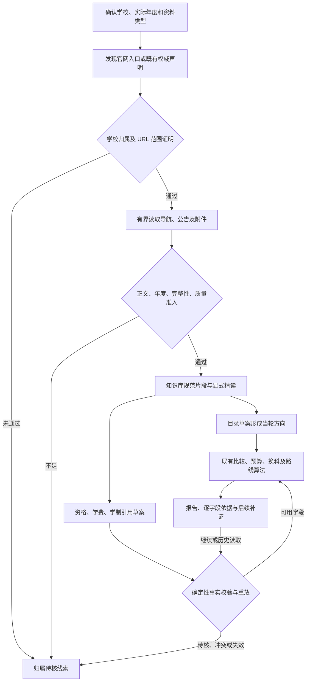

# 官网发现与报考事实进入算法

更新：2026-11-09。本页记录当前代码的两条有界闭环、操作入口和验证边界。本轮最终测试及 72 个单位的阶段统计见 [VERIFICATION.md](VERIFICATION.md) 最新记录及对应原始报告；不要把历史测试数量或目录名中的 `final` 当作完成证明。

## 1. 实际增加的能力

1. 元宝未命中、尚未配置或只返回疑似官方页面时，Agent 可以从已登记官网或已留档的权威声明继续寻找研招入口。新入口必须证明属于当前学校，再读取目标年度公告。已知官网、找到公告、正文可用分别报告。
2. 已精读的官方原文可以为当轮具体方向补充学费、学制和可执行资格条件。模型只定位、提交完整条款引用；程序解析值、判断范围、处理冲突，再交给现有确定性算法。

这两条路径不发布全国目录，不把搜索摘要变成资格事实，也不保证自动找到所有学校的公告。全国静态公开包仍为 **135 个目录单位、22,356 条专业或方向，2027 年度确认 931 个独立招生单位，通用索引 936 条**。本轮没有批量改写这些资料；当轮临时方向及补证事实不能计入静态覆盖率。



原文形成临时方向的行身份、科目 OR 组和 `tp_` 生命周期仍见 [ON_DEMAND_CANDIDATES.md](ON_DEMAND_CANDIDATES.md)。本页补充其后的官网归属和报考事实闭环。

## 2. 真实 API 与 Agent 工具调用顺序

HTTP 入口仍是 `POST /api/research`、`POST /api/research/continue`、`GET /api/research?research_id=…&after_event=…` 等既有研究接口，返回 `{ok,data,error}` 信封。下面是 `research_tools.py` 中注册的 Agent 工具，**没有新增同名 HTTP 接口**。HTTP 参数与连接配置见 [RUNNING.md](RUNNING.md)。启动研究与继续研究可能调用已配置模型，不能把读取报告当成启动研究。

| 顺序 | 实际工具及参数 | 返回结果和下一步 |
| --- | --- | --- |
| 1 | `find_units({query, province?})` | 确认单位 ID；有登记官网时可返回 `official_source_id`，不能根据猜测的校名或域名补身份。 |
| 2 | `discover_official_entry({unit_id, year?, kind?})` | 从登记入口、可重放归属及已有权威声明找入口和目标公告；返回 `stage`、四组来源、错误和公开读取用量。该工具本身不调用付费搜索。 |
| 3，可选 | `search_official_sources({query, unit_id?, year?})` | 使用已配置的元宝寻找线索；目标年度和资料类型参与阶梯终止判断，普通官网或历史章程不能提前当成目标材料。付费请求另计预算。 |
| 4 | `read_official_source({source_id, unit_id})` 或 `discover_official_links({source_id, unit_id, depth?, limit?})` | 只读取已发现、已核准范围内的来源；从官网导航发现新 URL 仍需归属与正文检查。 |
| 5 | `search_knowledge_segments({query, entry_id?, unit_id?, year?})` | 在当前有效原文中定位完整行、资格章节、收费或学制条款；检索命中不是已读证明。 |
| 6 | `read_knowledge_segment({segment_id, before?, after?, max_chars?})` | 显式精读当前规范片段及完整上下文。工具层前后补读各为 0～2 段，字符预算 64～8,000；模型投影不能容纳完整块时必须缩小窗口。 |
| 7a | `propose_source_candidates({source_id, segment_id, drafts})` | 仅目录行与考试科目草案，通过后生成当轮 `tp_` 方向；它本身不确认资格和费用。 |
| 7b | `propose_admission_facts({program_id, drafts})` | 对已发现的具体方向，每批最多 6 条资格、学费或学制引用草案；返回事实状态、逐条拒绝原因。 |
| 8 | `compare_candidates`、`plan_subject_routes`、`suggest_adjustments`、`analyze_decisions` | 对已采用的当前字段执行现有引擎；既处理显示候选，也保留有界研究池中的目标方向，失效后清除旧算法缓存。 |

事实草案的 `drafts` 项只能有以下两项，金额、AST、完整性标志和“资格已符合”均不能由模型提交：

```json
{
  "field": "tuition",
  "citation": {
    "segment_id": "使用本轮实际读取返回的片段 ID",
    "char_start": 100,
    "char_end": 120,
    "quote": "使用该规范全文区间内逐字相同的完整条款或表格行"
  }
}
```

此例只展示 JSON 结构，位置和 ID 不可直接调用。`field` 仅允许 `tuition`、`duration_years`、`eligibility`。引用是规范全文的 Unicode 绝对半开区间 `[char_start,char_end)`；必须覆盖选中块的完整内容，不能裁掉例外或 OR 尾句。表格行所依赖的规范标题、表头也须有真实已读凭证。

## 3. 官网归属、公开导航和来源质量

`official_authority.py` 负责把“可能属于学校”变成可重放的归属证明，`research_official_tools.py` 将它用于研究工具；`public_navigation.py` 只解析导航，不联网、不执行 JavaScript。不能把这些职责合并成“URL 是 edu.cn 就可信”。

- 入口来自当前登记或复核绑定，或同单位、同身份的已留档权威声明。搜索命中只能提出候选，不能自行给域名授权。研招网学校账号材料可作为已留档声明，不能借此重新请求已受限的共享主站。
- 证明保留学校 ID、名称及代码、请求与最终 URL、逐步链接关系、原始字节 SHA、目标身份、发布者角色和检查时间。允许范围区分协议、主机、端口、精确路径或路径前缀、查询及账号标识；不会因为一个子站通过就放开其父域全部页面。
- 公众号等共享发布平台须核对发布者账号，不能把整个平台标为学校官网。已证明的例外端点也只限其获准范围；不会放行回环、内网地址或任意端口。
- 当前归属证明最长有效 **30 天**。重放重新核对单位身份、登记根、父证明、快照 SHA、链接关系与范围；可显式 `OfficialAuthority.revoke(id, reason)` 撤销。带联网 fetcher 的重放还能比较当前字节，**普通报告读取的本地重放不等于重新联网核实站点在线状态**。
- 原始归属证据位于隔离数据目录下的 `runtime/official-authority-proofs/`，索引为 `runtime/official-authority.sqlite`。短期导航缓存只在当前发现对象内复用，不是“官网永远有效”的负缓存；未找到材料也不会写成学校没有官网。
- 实际正文仍需经过 `public_sources.document_attribution`、实际招生年度识别、完整提取与知识库质量准入。页面可访问、归属已证明和 `quality.state=accepted` 是不同检查；`accepted` 也不代表其中每个字段已结构化核验。

公开导航支持已发布的链接、部分字面量跳转、iframe/PDF 包装和有限公开脚本中的静态导航表达。候选保留来源位置并由调用方重新检查范围，不执行任意 JS、浏览器登录、验证码或报名流程。个人名单线索会过滤。当前实现有每单位公开读取、时间、深度、字节及整轮导航预算，触及预算保留已找到的入口和真实错误，不把剩余队列说成已查完。

`official_discovery.stage` 区分 `entry_verified`、`document_found`、`body_read`、`verification_required`、`access_restricted`、`no_lead`。四组来源为 `entry_sources`、`navigation_sources`、`document_sources`、`candidate_sources`；逐项 `errors` 和质量状态必须一起看。阶段并不覆盖每一种同时存在的失败：例如官网已登记但当前访问受限，仍可能保留 `entry_verified` 并在错误中报告限制。

## 4. 资格、学费和学制怎样参与计算

`admission_facts.validate_fact_drafts(unit, year, program, drafts, resolver)` 是纯校验器；`research_admission_tools.py` 负责已读凭证、保存、重放、恢复原值及应用。它们不改正式目录、知识库原件或用户画像。

| 字段或状态 | 当前可执行边界 |
| --- | --- |
| 适用范围 | 学校、实际招生年度、专业代码、学习方式和原文明示学位类别必须一致；明确全校适用时可采用学校级条款。院系、方向或例外标题不能从其他行借用。学位类别不从专业代码猜测。 |
| 学费 | 解析完整金额和年费/全程口径；严格规范原文路径可标 `verified_single_source`，相同语义值被不同 SHA 原件独立支持才标 `corroborated`。不能把单个原件的两个链接算成两份依据。约数、上下限、待定、歧义金额及不适用的价格不当作精确值。 |
| 旧摘要提取路径 | `research_fields.py` 的自动摘要正则仍要求两份独立原件一致。新增严格路径没有静默放宽该旧规则；二者的证据和 `verified_by` 应分辨。 |
| 学制 | 单份同范围权威原文可以给出明确年数；区间、最长年限、未读续文和含未支持例外的条款保留未知。不会自动填充复杂 rowspan。 |
| 可执行资格 | 只对受支持的明确学历、工作年限、本科专业等语法生成 `grad_engine` 条件 AST；独立 OR 保留 `any`，不能把跨学历关联分支拆成独立组合。 |
| `partial` | 部分条件可执行，但资格覆盖不完整。明示冲突可用于排除，符合部分条件仍不能成为“资格已符合”。普通“报考条件”标题或一条本科条款不证明整体完整。 |
| `needs_review` | 原文当前可信、引用和专业范围已经通过，但条件无法用现有画像执行；保存完整待核证明，值为空规则束、完整性为假。不能把健康、纪律等未支持条件丢掉后宣布符合。 |
| 完整资格 | 需范围明确、显式完整条件声明、相关条件全部可执行且无待核限制。多份当前证明中只要仍有相关未解条件，完整性继续为假；模型不能提交或直接修改该标志。 |
| `conflict` | 同范围事实互相冲突或与已采用旧字段矛盾时，该字段暂停；不按来源新旧或排序挑一个。其他无冲突字段可继续使用。 |
| `stale` | 原件、归属、提取代次或已读证明失效后，退出计算，保留审计原因。 |

同批有被拒绝的资格草案时，本批其余资格事实也暂停采纳，避免保存成功子集、下次单独重放后误变完整。学费、学制不因此自动丢弃。错误学校、年度、来源或特殊计划范围仍拒绝，不能把不适用条款当作普通计划的资格证明。

当完整资格解除的只是临时候选默认“目录不足以证明资格”的审核状态，且目录证明仍有效、没有实质备注、科目身份问题或字段冲突时，才可解除该默认状态；正式目录原有审核原因不会被通用地清空。

年费、总费和学制由 `grad_engine` 按原口径计算。年费乘有效学制形成总费时，解释必须同时包含收费与学制依据；全程学费不能冒充年费。预算可排除不合适方向，仍不代表已通过所有报考资格或保证录取。

## 5. 读取凭证、保存与失效传播

1. `read_knowledge_segment` 返回的是实际完整规范块。`research_model_projection.project_segment_read` 保持预算；完整正文未送达时不能签发“完整已读”凭证。研究服务按实际发送投影调用 `confirm_segment_delivery`，不能把检索命中或内部读过但未送达的内容当成模型已读。
2. 凭证绑定来源、学校、年度、原件 SHA、提取 ID、generation ID、字符范围、正文摘要及读取窗口。事实证明保留原始 `proof.draft`、完整条款和范围依据；报告中的已保存数值或 `verified` 文本不提供权限。
3. 每次恢复或应用都按当前知识库及已读凭证重跑草案，并核对稳定事实 ID。无关补读不会改变事实身份；新的同范围矛盾、未解析限制和范围变化则必须影响可用状态。
4. 当轮采用使用可恢复的字段覆盖层。比较、完整研究池、继续任务、任务列表与历史详情都复核当前状态；原文撤信、SHA 或提取代次变化、归属证明过期/撤销后，停止相关事实参与计算，并恢复此前原值或未知状态。
5. 失效会清除旧比较、决策和证据解释缓存；显示审计仍保留。读取旧报告不会回写原始研究日志、重建正式目录或自动恢复付费调用。恢复信任也必须重新通过来源、范围和证明检查。

## 6. 已验证的真实原件与可复查产物

北京服装学院 2027 年公开原件保存在 `tests/fixtures/source_candidates/bift2027/`，不含个人考生名单。目录与章程是原始公开 HTML，保留其真实招生年度、获取时间和逐字节 SHA。

- 前一闭环验证 `082104 服装设计与工程 / 01 功能性服装研究` 从原文形成当轮方向并核算考试科目，本轮没有为它推断完整资格。
- 本轮 `tests/test_admission_facts.py` 从章程完整 HTML 经生产提取器、临时知识库、实际片段和已送达凭证，确认首个明确收费行 `140300 设计学` 的 **8000 元/年**及其全日制收费范围。
- `082104` 的 rowspan 缺金额不会继承邻行 6000；后续收费行被现有分段器识别成错误专业标题时也不能借范围。章程“除国际商务外……”的学制例外继续未知。
- 上述属于**隔离临时库中的已记录官方原件回放**。前端浏览器验收使用隔离 API 夹具，检查状态、精确引文跳转、输入法和响应式行为；两者都不是实际远端 AI/元宝付费效果证明。

本机本轮产物根目录为 `D:/CodexRuntime/yanxu-closure-upgrade-20261109/`，未随仓库分发的路径在其他机器上可能不存在：

| 产物 | 怎样使用 |
| --- | --- |
| `coverage/live-regression32/`、`coverage/live-heldout40/` | 公开网络基线留档：`sample.json`、`report.json`、`recordings.json`、逐请求原件。前者是研究过的失败样本，后者是已登记入口样本，不是未绑定入口的随机全国覆盖。 |
| `coverage/replay-regression32-final/`、`coverage/replay-heldout40-final/` | 对已有录制的代码重放及 `failure-analysis.json`。目录名不证明最新代码已覆盖全部请求；新增请求在旧录制中缺失时必须单列 `recording_gap_after_code_change`。 |
| `coverage/evaluator-coverage.json` | 评估器代码覆盖报告；不等于官网命中率。 |
| `facts/coverage.json`、`facts/validation.json` | 事实校验器模块及本轮定向验证记录；已观察的 `admission_facts.py` **约 96% 语句覆盖率**仅指该模块、该次测试，不能推广成全仓覆盖率或真实招生正确率。 |
| `navigation/`、`root/`、`review/` | 导航、工具集成、生命周期及独立检查的红绿测试与回归记录。 |
| `ui/browser-official-closure.json`、`ui/closure-*-fixture.png` | 隔离浏览器检查和界面截图，明确属于夹具验收。 |

官网评测分别计量 `entry_verified`、`requested_document_located`、`requested_body_read`、`source_evidence_complete`、`expected_article_discovered`。目标文章 URL 只在发现后评分，不得作为生产导航种子。读到首页、公告列表或一条 PDF 附件通知不能算正文读全；历史年度也不能改成请求年度。每份报告同时检查 `source_sha256`、`finished_source_sha256`、`source_changed_during_run`、时间、分母及逐校错误。本页不固定仍在复跑的 32/40 样本成功数或整库测试总数。

## 7. 运行与测试

在安装了仓库依赖的隔离 Python 环境中运行；完整公共资料依赖 `ijson` 等 `requirements.txt` 项。环境准备、PDF 原文与坐标工具的区别见 [RUNNING.md](RUNNING.md)。不要为了测试复制用户运行库、连接设置或凭据。

```powershell
python -X utf8 -m unittest tests.test_official_authority tests.test_public_navigation tests.test_official_target_ladder tests.test_research_official_tools tests.test_official_discovery_evaluation
python -X utf8 -m unittest tests.test_admission_facts tests.test_research_admission_tools tests.test_research_candidates tests.test_source_candidate_tools tests.test_source_candidates_official tests.test_research_fields tests.test_research_field_lifetime
node --test tests/official-closure.test.mjs
node tests/browser-official-closure.cjs
```

浏览器脚本使用本机 Playwright；需要时按脚本支持的 `FORMAL_PLAYWRIGHT_PATH` 或 `PLAYWRIGHT_PATH` 指向已安装包。它自行建立随机回环端口与假 API，不使用正式服务端口、用户数据库或付费提供商。`OFFICIAL_CLOSURE_UI_OUTPUT` 可指定独立截图输出目录。

对已有公开录制做**不联网**重放，输出新目录，保留基线：

```powershell
$discoveryReplay = Join-Path $env:TEMP ('yanxu-discovery-replay-' + (Get-Date -Format 'yyyyMMdd-HHmmss'))
python -X utf8 tools/evaluate_official_discovery.py --cohort regression32 --replay D:/CodexRuntime/yanxu-closure-upgrade-20261109/coverage/live-regression32 --out (Join-Path $discoveryReplay 'regression') --workers 4
python -X utf8 tools/evaluate_official_discovery.py --cohort heldout_registered --heldout 40 --replay D:/CodexRuntime/yanxu-closure-upgrade-20261109/coverage/live-heldout40 --out (Join-Path $discoveryReplay 'heldout') --workers 4
```

路径应替换为本机已有留档。重放缺少新请求不会回退网络。确需重新公开联网测量时，移除 `--replay`、使用全新 `--out`，保持同主机间隔至少 2 秒；工具只开临时测试库、不调用付费模型、不把人工已知文章 URL 当入口，也不解除研招网门禁。重放与联网的结果应分别报告。

若要手动检查页面而不碰现有运行库，可先将公开数据包恢复到独立目录，再用随机回环端口启动：

```powershell
$closureScratch = Join-Path $env:TEMP ('yanxu-closure-smoke-' + (Get-Date -Format 'yyyyMMdd-HHmmss'))
python tools/prepare_data.py --target-dir $closureScratch
python -X utf8 server.py --host 127.0.0.1 --port 0 --data-dir (Join-Path $closureScratch 'data')
```

服务地址以启动输出为准。此操作不会复制已发布运行索引或连接配置；未在隔离目录发布目录时，相关接口可能如实显示未发布。单纯启动页面不能代替本页的工具链或付费端到端验收。

## 8. 接手后的优先检查与仍未解决的问题

1. **先读当前版本验收，再对新改动重测。** 核对评测报告源码 SHA、重放缺口与最终主分支修改，不以历史 SHA 或中途成功数字充当当前结果。当前整库测试、必要浏览器回归及公开网络阶段统计已在 `VERIFICATION.md` 汇总。
2. **按真实失败种类补最小链路。** 保留 `authority_or_publisher_scope`、`public_access_or_transport`、`bounded_navigation_exhausted`、`body_or_attached_original_not_read`、`historical_material_observed` 等类别，避免把归属未证、HTTP 失败或预算结束写成学校没有官网。重放录制缺口须单列，不能算算法真正导航到终点。
3. **附件与复杂网页仍不完整。** 部分脚本动态接口、分支函数、复杂 iframe/表单、需交互渲染内容及未取得的 PDF 附件仍可能无法读全；不执行任意 JS 或绕过站点限制。必须拿到实际附件，提取和质量通过后才可能进入规范片段。
4. **资格语法仍窄。** 国籍、健康、纪律、等同学力、跨学科附加要求、专项计划和复杂关联分支不能靠改完整标志解决。扩展前先补有真实来源、严格范围和否定反例的测试；待核证明不能在继续/继承时遗失。
5. **表格解析边界继续保留。** 不自动展开复杂 rowspan、跨页表头或关联科目套组；不能只让某一显示入口看起来正确而破坏预算、排除、换科和路线共用语义。
6. **全国静态覆盖和用户真实库维护是另一项工作。** 本轮没有补齐剩余年度单位，也未维护真实知识库的旧摘要、全文代次或向量索引；历史语义评测的内存限制与未完成项依旧有效。完整维护要按现有流程单独盘点与操作，不能把临时库结果写回用户库。
