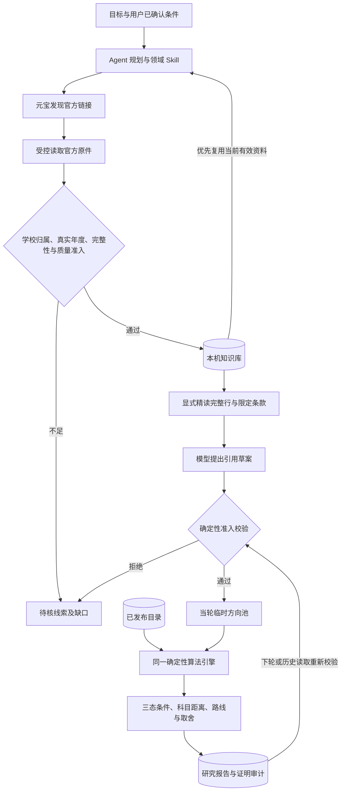

# 从官方原文到当轮候选

更新：2026-11-09。此文记录本轮新增能力、信任边界、实现入口和后续检查点。全国单位索引继续承担定位职责；本轮没有批量补齐或重写全国专业目录。

## 1. 用户能完成什么

以前，Agent 能搜索未入库学校的公告、保留链接和原文，但比较算法只能使用已发布目录中的方向。现在，对于结构清楚、当前仍有效的官方目录行，Agent 可以整理草案，交给程序校验后形成 `tp_` 临时方向，直接参加本轮科目比较、条件调整及路线分析。

界面把这些方向与已发布方向按学校组织，标出“本轮从原文整理”。**能核算科目不等于已核准报考资格**：资格仍待核，未知费用、学制和其他条件保持未知。临时方向随研究报告保存，不借用正式目录 ID，也不会进入旧的正式目录收藏或档案入口。

知识库详情区分来源信息、原文、可定位片段和语义索引。可补证的线索提供“让 Agent 补证”，点击后先打开可编辑草稿，明确提交才创建研究、可能调用模型；打开详情和编辑文字不会启动付费任务。

## 2. 数据流与算法位置

没有另建一套模型打分。临时方向复用 `grad_engine`、`planning_engine` 与现有决策引擎：按考试单元及“科目代码＋命题范围”比较，执行条件三态、排除项、偏好及路线分析。没有资格证据时不会变为 `matched`，算法得分也不是录取概率。

显示最多 12 个方向；有界临时池最多 24 个。当前条件硬排除的方向仍在完整研究池中，放宽换科上限等反事实分析可以复算，不能只从展示的 12 条恢复。公开目录扫描完成也不等于新学校或全国目录完整。

## 3. 草案怎样获得计算资格

`propose_source_candidates(source_id, segment_id, drafts)` 每批最多 6 条。模型仅能提交专业代码、名称、院系、方向、学习方式和规定格式的引用，不能提交学校、年度、候选 ID、学费或报考资格。

1. 学校和实际招生年度从当前官方来源推导，不使用目标入学年或请求年冒充原文年度。仅有搜索摘要、待核来源、失效来源均不准入。
2. 正文必须来自显式 `read_knowledge_segment` 的已读窗口。搜索命中、模型摘要及未传送给模型的正文不能获得已读凭证。
3. 每条引文是同一提取代次规范全文中的 Unicode 绝对半开区间 `[char_start, char_end)`；逐字匹配，不模糊修复位置。
4. 专业身份及考试科目须属于同一完整实际目录行。禁止跨行借用科目、跨校跨年拼接；截断、续行、OCR 不清或语义关系不明继续待核。
5. HTML 提取保留真实 `tr/td` 行列分界和制表符；单元格内的段落、换行及排版空白不再拆散目录行。不自动展开 `rowspan` 或替缺列补身份。
6. 明确适用同校同年度全部专业的政治、学习方式声明可以单独引用。独立编号条款按完整条款及续行验证；同条款及相关例外不得裁掉。
7. 考试单元须连续完整；全国统考代码和名称相符，自命题代码保留本校作用域。逐单元独立 OR 可计算；关联套组及未解析条件不压成不存在的笛卡尔积。自命题课程仅接收可证明的简单原子名称，复杂条件长括注和多余考试代码先拒绝。
8. 显式其他年度、示例、历史或停招目录行不能作为本年招生方向。来源真实，并不意味着文中每一行都适用。

这是明确支持结构的首版，不能声称能准确理解任意自然语言或任意 PDF 表格。被拒绝的草案返回原因，补读或更换明确依据后才可重试。

## 4. 保存、继承和撤信

| 数据 | 保存位置 | 作用 |
| --- | --- | --- |
| 官方原件 | 现有 SHA 原件留档 | 完整性校验，离线复查与提取 |
| 规范全文、结构片段 | 现有知识库 SQLite 与提取代次 | 按章节、段落、真实表格行定位原文；可选向量索引仍独立维护 |
| 当轮临时方向 | 现有研究 SQLite 的报告 JSON | `research_candidates` 保存完整有界审计，`candidates` 为显示摘要 |
| 方向证明 | `candidate_proof` 与 `evidence_refs` | 原始草案、字段原句、绝对位置、SHA、提取及分段代次 |
| 已读凭证 | `read_receipts`，最多 64 个 | ID、范围、摘要哈希与读取参数，不再复制无限正文 |
| 正式专业库 | 原有显式发布版本 | 本次不会自动写入、扩大或改标其核验状态 |

模型阅读投影仍有 6,000 字符预算：完整块放不下时省略正文并要求缩小范围，绝不截短正文后保留“完整已读”资格。每次发送后，用实际送达的块确认读取凭证。

多词结构检索先排同段全部命中，同时保留同一当前原文中的相关补充段，避免精确科目行遮住前文适用范围。补充候选要求整份原文包含全部查询词，片段至少命中一词，逐段标记 `document_terms`，不借其他文档拼词；学校、年度、质量和当前代次过滤及读取预算保持有效。这会增加多词查询的同文候选数和一次查询成本，不能称为性能提升，也不能将补充段当作同一联合事实。

比较、路线、报告、跨轮恢复和历史读取均重查当前来源。原件篡改、撤信、版本或提取代次变化后，方向退出可计算池，旧算法解释失效，原有审计和失效原因保留。恢复时从证明重新生成规范字段，不能直接信任旧报告里可被改动的科目、资格或费用值。

`knowledge_entry_id` 是补证请求唯一允许传入的来源标识。服务端重新取得学校、真实年度与质量状态；显式所选学校或参考年度冲突时拒绝。已复核多域名学校与 Agent 共用官网绑定规则。未知年度仍为未知，不从目标年补写；线索也不能因此升级为可信事实。

## 5. 真实原件验收及边界

[北京服装学院 2027 专业目录](https://yjs.bift.edu.cn/zsgz/zsjz/60e13ef56ce242b59e374b9ada5e2f7f.htm)与[同年度招生章程](https://yjs.bift.edu.cn/zsgz/zsjz/64c1825a0599471b8619fd8c792f8802.htm)提供一个未在旧专业包中的学校案例。两份原件于 2026-11-09 获取，来源和 SHA 在 `tests/fixtures/source_candidates/bift2027/` 记录。

验收从完整 HTML 经生产提取器、临时知识库、真实结构片段、模型投影及读取凭证，整理 `082104 服装设计与工程 / 01 功能性服装研究`，按完整 `101 / 201 / 302 / 902` 组合核算零换科，并验证错误位置拒绝、章程撤信及原件篡改后的失效行为。资格仍未知。

这是**隔离库中的离线官方原件回放**，不是实际元宝或远端 AI 调用；一个方向通过不表示整校或全国目录完整。新 UI 的浏览器验收也使用隔离 API 夹具，不能称为真实付费研究效果。

## 6. 接下来按节点推进

| 节点 | 目标与最小产出 | 验收门槛 |
| --- | --- | --- |
| A，本轮 | 原文→当轮方向→算法→报告→失效重验；补证草稿与库存状态 | 新学校真实原件回放、完整回归及独立复查，见 `VERIFICATION.md` |
| B，优先 | 资格、费用、学制的证据闭环；让计划优先补影响结论的未知项 | 正例、否定、例外、多来源冲突、撤信、多年范围均能重放；减少资格待核需要实际证据，不能只改完整性标志 |
| C | 知识库全文维护队列：区分缺原件、旧摘要、待 OCR、失败代次与索引状态 | 先只读盘点与备份；显式启动、预算、停止、重试；失败不替换旧可用代次，不能自动计费 |
| D | 扩充真实目录结构测试族，支持可证明的表头继承、rowspan、跨页及合法关联套组 | 每种结构先加独立真实样例和反例；所有科目排除、距离、路线共用合法组合，禁止只修一个入口 |
| E | 完成资源足够环境中的 34 题语义配对；再评估自然语言关键词、批量查询及排序稳定性 | 同输入、同预算、相同来源集，分别报告出处召回、全部必要引文、可信引用、成本和延迟；语义相近不冒充报考相同 |
| F | 小规模真实用户任务与交互打磨 | 关注“找到可比较方向所需步骤、读懂待核项、能回到精确原文”；先测再改，不额外堆叠面板 |

全国索引保留，专业及细节按需求精读并积累。未来仍应测量遗漏率、学校分布和每次研究的已覆盖范围；全国可检索不等于全国已搜全。
