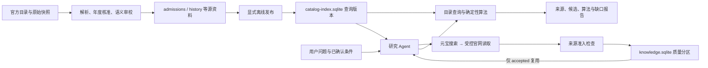
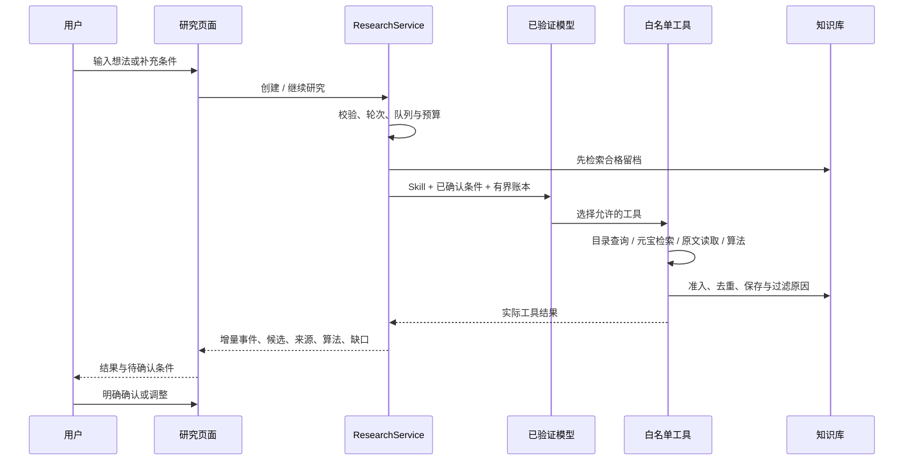
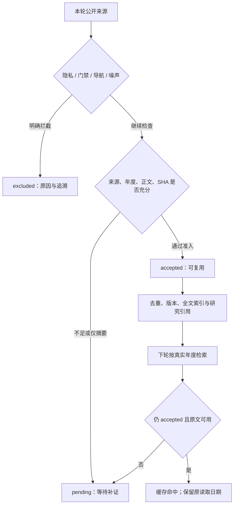

# 研序 AI · 项目介绍与开发交接地图

> 仓库：[`xiaosongxiaosong1111/yanxu-ai`](https://github.com/xiaosongxiaosong1111/yanxu-ai) · 更新：2026-11-04

这份文档面向接手项目的开发者或 AI。先理解三条数据路径，再按模块定位问题；无需先通读所有采集器或历史规划。

## 1. 先建立正确认识

研序 AI 是一个面向全国考研规划的本地研究 Agent：用户输入专业意向、备考科目或地区，AI 安排研究，元宝 SearchPro 发现官网来源，程序核对原文并用确定性算法比较候选。搜索中有价值的资料经过准入后沉淀进知识库，下次研究优先复用。

当前默认 2028 入学规划、2027 参考资料。专业目录可以按年度发布，新的网页不会直接变成确定性算法的输入。全国可检索、资料已留档、结构化目录已发布、字段已核验是不同状态。

当前是 **Python 本地 HTTP 服务 + 原生浏览器模块**，不是 React/Next.js 项目。运行时使用本机 SQLite 和文件留档；没有公开多人账号隔离。Windows 的已保存密钥绑定当前操作系统账户，不应作为跨机器配置复制。

阅读顺序：

1. [README](../README.md)：产品、运行入口、真实截图与交付方式。
2. [需求与验收标准](REQUIREMENTS.md)：功能、交互、数据边界和后续需求。
3. 本文：模块地图、数据流和修改入口。
4. [运行说明](RUNNING.md)、[Agent 接口契约](AGENT_UPGRADE_PLAN.md)：安装和精确字段。
5. [验收记录](VERIFICATION.md)：实际执行过的检查及未覆盖边界。

执行顺序见 [Agent 与知识系统升级任务表](AGENT_ROADMAP.md)。节点1—3已完成独立验收；4C2 与节点5–7已由 Claude 本地交付并待 Codex 复查，包含 Milvus Lite 语义索引、确定性计划账本、证据继承/字段候选和决策界面。最新验证状态见 [Claude 交接](CLAUDE_HANDOFF.md)；真实付费模型、元宝与 4180 主端口仍未在本轮运行。

[初版契约](PRODUCT_CONTRACT.md)、[早期实现基线](IMPLEMENTATION.md)、[V3](V3_PLAN.md)/[V4](V4_PLAN.md) 记录演进背景，含当时尚未接入 AI 等历史描述。判断当前能力时以代码、本文及 Agent 契约为准，不应照旧规划删除已经存在的接口或重建另一套应用。

## 2. 三条核心数据路径



| 路径 | 能产生什么 | 不直接产生什么 |
| --- | --- | --- |
| 资料采集与发布 | 有版本的已审校目录、历史资料和字段依据 | 不靠下载数量宣布全国完整 |
| 用户研究 | 有界任务、实际工具账本、候选比较、待确认条件与来源 | 模型自由文本不是正式招生事实 |
| 知识积累 | 来源版本、原文摘录、可检索正文、质量与引用关系 | 不自动改写 `admissions.json` 或已发布目录 |

新增网页要进入正式算法，须另行完成字段提取、范围和年度核对、审校及发布，不能跳过左侧发布路径。

## 3. 代码入口与模块地图

| 责任 | 入口 | 接手时重点看什么 |
| --- | --- | --- |
| 启动、HTTP 边界 | [server.py](../server.py) | 回环绑定、同源、请求大小、查询参数、限频和统一信封 |
| 应用服务与组合 | [service.py](../service.py) | 发布查询、原接口兼容、设置/研究/知识库惰性初始化 |
| Agent 调度 | [research_service.py](../research_service.py) | 队列、工作线程、模型上下文、预算、取消、继续与工具事件 |
| 研究工具与报告 | [research_tools.py](../research_tools.py) | 白名单、候选扫描、原文边界、算法核算、来源账本、知识库计数 |
| 任务与事件 | [research_store.py](../research_store.py) | SQLite 状态转换、轮次、增量事件、重启恢复 |
| 资格与排序 | [grad_engine.py](../grad_engine.py) | 三态条件、科目距离、费用口径、排序依据、Pareto、历史匹配 |
| 路线与调整 | [planning_engine.py](../planning_engine.py) | 0/1/2 路线、允许枚举、覆盖去重、最小变更与增减 |
| 发布查询 | [published_catalog.py](../published_catalog.py)、[catalog_index.py](../catalog_index.py) | 查询版本、分页、科目聚合、版本不一致处理 |
| 源资料验证 | [service_verification.py](../service_verification.py)、[catalog_replay.py](../catalog_replay.py) | SHA、原文重放、完整性与语义审校 |
| 字段原文依据 | [evidence.py](../evidence.py)、[catalog_facts_store.py](../catalog_facts_store.py) | 精确引文、字段路径、适用范围、冲突与对外脱敏 |
| 来源抓取与补证 | [public_sources.py](../public_sources.py)、[source_proof.py](../source_proof.py) | 官网归属、公共目标限制、原文提取及补证范围 |
| 变化关注 | [radar.py](../radar.py) | 订阅、基线、来源版本和字段变化，勿误当外部推送服务 |
| 知识库 | [knowledge_store.py](../knowledge_store.py) | 版本去重、FTS、SHA 撤信、官方归属证据、迁移与复用 |
| 知识准入与隐私 | [knowledge_quality.py](../knowledge_quality.py)、[source_privacy.py](../source_privacy.py) | 可解释准入、真实正文、年度冲突、导航噪声与个人名单 |
| 模型及搜索接入 | [provider_catalog.py](../provider_catalog.py)、[ai_transport.py](../ai_transport.py)、[yuanbao_auth.py](../yuanbao_auth.py) | 端点、协议归一、模型目录、TC3 与 API Key 两种鉴权 |
| 连接与秘密 | [settings_store.py](../settings_store.py)、[secret_store.py](../secret_store.py) | 测试收据、同配置复用、DPAPI 与非 Windows 会话模式 |
| 大文件读取 | [json_reader.py](../json_reader.py) | 超过 32 MiB 时使用固定版本 `ijson`，避免整读双份字符串 |
| 公开资料恢复 | [tools/prepare_data.py](../tools/prepare_data.py) | 标准库离线解包、manifest/SHA 校验、保护已有文件；恢复不等于发布 |

### 前端地图

| 页面/能力 | 文件 | 关键说明 |
| --- | --- | --- |
| 页面壳与路由 | [static/application.mjs](../static/application.mjs)、[view-state.mjs](../static/view-state.mjs) | hash 路由、轻量 bootstrap、分页、弹层和独立页面生命周期 |
| 研究 | [static/agent.mjs](../static/agent.mjs) | 状态合并、轮询、草稿、条件确认、真实 Skill/来源/算法呈现 |
| AI 与元宝设置 | [static/settings.mjs](../static/settings.mjs) | 厂商切换、模型完整选择、连接测试、保存收据与双鉴权 |
| 知识库 | [static/knowledge.mjs](../static/knowledge.mjs) | 质量分区、筛选分页、详情、准入原因、请求竞态 |
| 专业与历史图 | [static/details.mjs](../static/details.mjs)、[charts.mjs](../static/charts.mjs) | 原始口径、历史缺年、数据点依据 |
| 方案工具 | [static/workbench.mjs](../static/workbench.mjs)、[workbench-views.mjs](../static/workbench-views.mjs) | 路线、最小调整、关注、补证与对比 |
| 字段来源 | [static/evidence.mjs](../static/evidence.mjs)、[evidence-model.mjs](../static/evidence-model.mjs) | 原文抽屉、来源列表、支持/冲突/引用链 |
| 覆盖与待核原表 | [static/collection-progress.mjs](../static/collection-progress.mjs)、[catalog-facts.mjs](../static/catalog-facts.mjs) | 单位覆盖、目录缺口、原表事实与不可推荐状态 |

前端主题为冷白、炭黑、钴蓝，沿用现有 CSS 与图标系统。`static/data.mjs` 承载资料适配函数，不是硬编码的正式招生库；新增页面应复用发布查询 API。

## 4. 一次研究如何执行



1. `AdmissionService` 惰性创建研究服务；未验证模型不会开始外部研究，但可保存等待配置任务。
2. `ResearchStore` 保存原问题、已确认条件、轮次和事件；单工作线程处理有限队列。
3. 基础四份 Skill 实际读取；涉及复试/调剂时加载第五份。文件和工具映射见 [skills](../skills) 与 `SKILL_CATALOG`。
4. `ResearchService` 先检索知识库，再将 Skill、用户条件和有界摘要交给模型。完整原文与报告另存，不假装模型看到全部内容。
5. 模型只能选白名单工具。候选来自已发布目录；新来源可进入研究或待核知识，不直接进入正式算法。
6. 候选或条件变化后程序确保匹配重算；完整备考科目才自动计算路线。未知足以改变结论时先请用户确认。
7. `report` 由工具事实账本派生；自由模型段落不替代字段、数值、官方引文或确定性结果。
8. 取消阻止后续调用，继续须等待 `can_continue=true`。新轮报告重新生成，上轮进入 `previous_report`；重启不自动重发付费请求。

### 五份 Skill 的职责

| Skill | 职责 |
| --- | --- |
| [understand-intent](../skills/understand-intent/SKILL.md) | 理解需求、确认歧义、提出有原句依据的条件提案 |
| [research-official-sources](../skills/research-official-sources/SKILL.md) | 复用合格知识，有限预算下发现官方资料，保留实际检索范围 |
| [verify-evidence](../skills/verify-evidence/SKILL.md) | 区分摘要、原文和已采用字段，处理范围、冲突和隐私 |
| [compare-plans](../skills/compare-plans/SKILL.md) | 使用实际算法解释科目、费用与方案取舍 |
| [assess-transfer-options](../skills/assess-transfer-options/SKILL.md) | 研究历史复试与调剂规则，避免把历史可能性变成当年名额承诺 |

前端的 `not_loaded / loaded / used` 分别表示未加载、规程已加载、关联工具成功执行；`used` 不证明模型完全遵守了所有规程。

## 5. 算法的实际含义

### 5.1 先约束，再解释排序

`match_programs(programs, profile)` 先保留参考年度数据，再对资格、未解析条件、费用、地区、学习方式和科目逐项形成理由。任何明确冲突可排除；仍有未知就进入待确认，缺资格章程不因目录完整而自动通过。

科目身份使用 `(code, scope)`，再按 `exam_unit` 及同组 OR 备选比较。距离是需要调整的考试单元数，不是科目名称的字符串相似度；缺备考信息、错误备选组、科目标识待核时结果未知或不支持匹配。

`excluded_subjects` 独立表达不愿参加的科目，与已准备的 `subjects` 分开。过滤禁项不能证明原本不明确的 OR 组合合法；合法替代方案会重新计算换科。明确冲突不被其他单元的未知抹掉。排除项自身 scope 为未知值时拒绝；缺少自命题作用域时保持待核，不能默默当成已经避开。

### 5.2 排序与 Pareto

- 科目分项基于需要调整的单元占比；费用分项只使用可比较的真实费用。
- 综合分仅在有效分项齐全时为确定值；缺失分项给出区间、缺失项及排序依据，不直接赋零。
- `provinces` 是硬条件，`preferred_provinces` 是软偏好；后者只有在综合模式且地区权重大于0时参与加权。费用/科目优先仍按其主要依据排序，地区零权重不改变顺序。费用优先可在全程费用不足时按已知年费比较，必须说明回退口径。
- Pareto 前沿仅对明确条件匹配、有效分项完整的项目计算。实现使用排序和前缀最大值树的 skyline，避免对全国候选做简单两两扫描。
- 偏好分表示用户设置下的取舍，不是录取概率。

### 5.3 路线与最小调整

`plan_routes` 分别用 0、1、2 个考试单元上限重新计算，给出新增、保留、移除和未知数量；不改变学历、背景、地区等其他事实。

`suggest_adjustments` 仅枚举用户显式允许的 `max_subject_changes / provinces / max_annual_tuition`，最多 128 个组合。优先最少改变字段，再去重和去除被支配选项。待确认方向可以保留为研究候选，但 `feasible` 仍依据已知条件匹配数量，不把待核算作已可申请。

候选变化时，依赖的 matching、routes、adjustments 会失效，避免把旧集合的试算展示为新结果。条件提案逐字段附原句、条件种类和冲突提示，确认后才进入下一轮算法。

### 5.4 先筛选，再精选

`find_candidates` 使用固定发布 revision，逐页读取查询范围的完整候选行，再做硬筛、粗排和跨校精选。显式选择学校仍最多8所；按省份推导学校不再截取前8所，也不依据其他默认年度的 program_count 跳过学校。未发现符合地区的学校时不回落全国。

结果分别保存 `total_in_query / total_complete`、`scanned_count / scan_complete`、硬筛排除数、待确认数。本次入选通过 `query_candidate_ids / selected_count` 表达，累计精选通过 `candidate_ids / cumulative_selected_count` 表达，并记录 `carried_over_count`。`candidates` 仍是本轮累计精选集合，不能把其中所有记录解读成本次学校查询的新命中。

预算截止、取消、提前空页及已知发布版本变化会保留一致版本的已得成果。尚未拿到有效COUNT时总数未知；未知系统异常继续向上抛，不伪装为正常部分完成。扫描不完整时任务不能标为 completed。

历史复试/调剂匹配和敏感性分析在 [grad_engine.py](../grad_engine.py)；它们逐年份保留来源，不提供当年缺额预测。

## 6. 知识库如何积累而不变成资料垃圾堆

`KnowledgeStore` 独立于正式招生库。保存前校验公共 URL、敏感内容、类型、年份、原文完整性和来源归属；不相信来源自带的“quality=accepted”或“官方已验证”标志。



要维护的关键性质：

1. 搜索片段永远待核。目录只有下载入口时不能认作已取得专业正文。
2. `accepted` 不是字段已核验；网页知识仍不能自动写入发布目录。
3. 相同 URL 合并弱摘要，SHA 识别原文版本与同源；多个链接和多次引用不冒充独立印证。
4. 命中旧强记录须采用其真实内容、年度、SHA 和读取时间，不能把旧质量标签贴给新垃圾摘要。
5. 原文每次使用时核 SHA；缺失或同长度篡改也会撤信。查询分页、计数和过滤须与降级状态一致。
6. 新拦截内容不写知识库；已有拦截记录保留离线审计但不向 API/FTS 提供正文。个人名单继续做专门隐藏。
7. `search_knowledge` 再次核对状态、质量、实际年度和原文可用性；缓存不计新的搜索/原文读取，也不称刚联网核验。
8. 规则过滤与存储故障分别计数；后者才进入真实保存缺口。

知识库旧记录无有效质量标记时默认待核。升级前先备份，再显式 `reassess()` 事务重分类；失败回滚，不删除研究任务或修改连接配置。

### 原文、提取、结构片段和索引代次

N3 将有界详情与完整提取稿分开：原件上限 8MB，规范提取稿上限 200 万 Unicode 字符、1000 页，超过上限明确标为 `partial`。旧详情仍限制 32000 字符，不把全文直接塞进模型。

| 层 | 实现与存储 | 关键约束 |
| --- | --- | --- |
| 原文件 | `public_sources.py`、`research-sources/<SHA>.bin` | 公共归属、下载限制、SHA 与隐私检查；离线重提取不伪造联网时间 |
| 规范提取 | `document_extraction.py`、`knowledge_extractions` | 独立提取器版本和文本 SHA，真实页与字符跨度；扫描 PDF 待 OCR，旧 DOC 不支持 |
| 结构片段 | `knowledge_segments.py`、`knowledge_segments` | 章节、段落、表头和表格行；主片段属于真实 PDF 页，跨页上下文单独引用 |
| 当前代次 | `knowledge_repository.py`、`knowledge_generations / knowledge_entry_state` | 仅当前成功代次可复用；`text == extraction_text[start:end]`；字符单位是 Unicode codepoint |
| 维护与重建 | `knowledge_lifecycle.py / knowledge_operations.py / knowledge_indexing.py` | 撤信、冲突、同范围版本选择、失败任务与幂等重试；质量不能由维护按钮直接升级 |
| Agent 与阅读 | `research_knowledge.py`、`static/knowledge-reader.mjs` | `search_knowledge_segments` 定位，`read_knowledge_segment` 有界补读；当前报告与历史报告复核来源 |

SQLite 继续保存权威状态和本地关键词索引；Milvus Lite 只保存可从合格片段重建的派生向量，不替代权威状态。检索先执行学校、实际年度、质量和当前代次过滤，再在有限候选中融合关键词与语义通道；返回前再次核对来源有效状态。直接片段 AND 无结果时，所有词必须先出现在同一提取稿，随后按片段覆盖词数排序；`match_mode=document_terms` 提醒它只是同文档定位，不能据此合并事实。语义索引必须由用户显式准备模型、测试保存连接并建立；打开页面、轮询和普通关键词搜索不下载模型或发起向量调用。

同一 URL、学校、实际年度出现不同完整文本时先标记冲突，由用户核对后明确采用；不同年、不同学校不自动替代。撤信不会删除审计，旧上下文和历史报告的摘录/解释停止被当作可信结果返回。旧库只读不自动建表或补造全文，显式写操作才事务迁移，缺质量列的旧标签仍待核。

格式支持和基线数据见 [知识评测](KNOWLEDGE_EVALUATION.md)，节点验收见 [N3](work_nodes/03-knowledge-workbench.md)。N6 已能从已读取原文产生带出处/年度/作用域的字段候选，年度学费需两份独立原文一致才参与推荐，冲突暂停；这些草案仍不直接写入正式发布目录。

## 7. 文件与存储分工

下表描述恢复后的逻辑位置。源码仓库通过 `data/bundles/` 的安全压缩包与 `manifest.json` 分发资料，超大的源 JSON 和完整开发缓存不直接提交；恢复步骤见下一节，具体包内容以 manifest 为准。

| 位置 | 内容 | 处理原则 |
| --- | --- | --- |
| `data/units.json` | 通用单位索引与官方入口 | 单位索引完整不等于当年目录完整 |
| `data/annual_registry_2027.json` | 参考年度招生单位核准 | 保留年度身份与通用索引差异 |
| `data/admissions.json` | 结构化专业、科目、来源与规则 | 正式源数据，不由模型自由输出直接覆盖 |
| `data/history.json` | 历史规则、线与匿名统计 | 原始个人名单不向前端提供 |
| `data/program_enrichment.json` | 已核对的扩展字段 | 保留来源和适用方向范围 |
| `data/catalog_semantic_audits.json` | PDF 表格语义批准 | 绑定原文、适配器和完整记录集 |
| `data/snapshots/` | 发布所需安全原文依赖 | 公开包仅保留经分发审查的依赖闭包，不分发完整采集缓存或逐人名单；非静态下载目录 |
| `data/bundles/` | 安全压缩包与逐文件 manifest | 版本化分发；先校验、恢复，再重建查询索引 |
| `data/runtime/catalog-index.sqlite` | 明确发布的查询版本 | 可再生成；运行时文件不提交源码 |
| `data/runtime/research.sqlite` | 个人研究、条件、报告与事件 | 私人运行状态，不当公共知识包分发 |
| `data/runtime/knowledge.sqlite` | 来源知识、质量、版本、全文索引与引用 | 与正式招生事实分离，默认仅可复用分区 |
| `data/runtime/research-sources/` | 研究原文 blob | 以 SHA 关联，公开接口不暴露本机路径 |
| `data/runtime/settings.sqlite` | 连接配置与受保护凭据 | 不上传、不复制为跨机器登录配置 |
| `data/runtime/` 下其余文件 | 雷达、补证、队列、验证产物 | 读取各服务约定，勿整目录当可公开数据导出 |
| `knowledge/research_rules.json` | 静态规则索引 | 与逐步积累的来源知识库不同 |
| 浏览器本地状态 | 收藏、对比、用户偏好 | 不是服务端多用户账户 |

首次克隆不含开发者的研究任务、已保存 Key 或动态知识库。知识库从本机后续研究中积累；README 中的真实运行截图不意味着这些私人运行状态随仓库提供。公开资料包也不应恢复开发机的 `data/runtime/`。历史个人名单原文不随包分发；相关录取聚合是否还能重放、是否进入发布，应以公开包的实际验收为准，无法复核时保持待核或不采用。

发布路径为 [collectors/publish_catalog.py](../collectors/publish_catalog.py)。它重放已保存原文、年度名单和审校批准后写查询 SQLite；直接改源 JSON 不会自动更新正在使用的发布版本。客户端按 `revision` 查询，旧版本分页不能与新版本拼接。

## 8. HTTP 接口速查

统一响应：`{ok, data, error}`；错误为 `{code, message}`。同源 JSON POST、不含 Key 的 URL、请求大小、Host 与限频检查不可绕过。

| 接口组 | 入口与用途 |
| --- | --- |
| 轻量目录 | `GET /api/catalog-bootstrap`、`catalog-programs`、`catalog-program`、`catalog-subjects`、`catalog-sources` |
| 来源与覆盖 | `GET /api/evidence`、`sources`、`collection-status`、`catalog-facts` |
| 确定性算法 | `POST /api/match`、`route-plan`、`adjustments`、`sensitivity`、`history/match` |
| 来源操作 | `POST /api/search`、`source-proof`、`radar/watch`、`radar/check`；可能读取外部来源或调用元宝，不作默认无成本测试 |
| 设置状态 | `GET /api/settings`、`settings/providers` |
| 设置操作 | `POST /api/settings/models`、`test`、`save`、`delete`；测试可能消耗外部额度 |
| 研究任务 | `POST /api/research`、`research/continue`、`research/cancel`、`research/delete`（仅终态任务，连同增量事件删除）；`GET /api/research` 读列表或任务/增量事件 |
| 知识库 | `GET /api/knowledge`，支持 `quality=accepted/pending/excluded/all`；详情用互斥的 `entry_id` |
| 精读原文 | `GET /api/knowledge/segments` 与 `knowledge/segment`；固定可信补读，字符预算与同版本邻接限制 |
| 知识维护 | `GET /api/knowledge/jobs`；`POST knowledge/state`、`knowledge/select-version`、`knowledge/reindex`；同源校验与独立维护限频 |

精确查询和正文参数见 [Agent 契约](AGENT_UPGRADE_PLAN.md)、[运行说明](RUNNING.md) 与 [server.py](../server.py)。普通 GET 读取任务不会调用模型；不要为验收界面自动重放真实研究。旧 `/api/chat` 返回 `not_configured`，与新研究 API 不混用。

## 9. 本地启动与验证

Python 3.11+；前端无需 npm 构建。[prepare_data.py](../tools/prepare_data.py) 只用 Python 标准库，离线校验压缩包及逐文件 SHA 后恢复到项目 `data/`，不发起搜索、模型调用或自动发布。首次克隆按以下顺序准备：

```shell
git clone https://github.com/xiaosongxiaosong1111/yanxu-ai.git
cd yanxu-ai
python tools/prepare_data.py
python -m pip install -r requirements.txt
```

运行依赖由 [requirements.txt](../requirements.txt) 统一锁定；开发验证另安装 [requirements-dev.txt](../requirements-dev.txt)，不要从历史验收记录复制旧 PDF 依赖。接着按 [RUNNING](RUNNING.md) 配置 `pdftotext` 与适配坐标表格的现代 Poppler，再执行下方发布和启动命令。原始资料大于 32 MiB 时须使用指定版本 `ijson`；不要通过整读超大 JSON 绕过依赖错误。

恢复工具会先检查全部包、成员路径、大小、SHA 和已有目标文件。相同内容跳过，不同内容拒绝覆盖；不会恢复运行时目录。若当前是含完整采集资料的开发目录，不应删除或覆盖旧数据来强行安装公开包，应在新克隆目录验证。工具另支持 `--bundle-dir` 与 `--target-dir`，便于在干净位置验收恢复，目标参数指向项目根而非 `data/` 子目录。

恢复安全资料、安装依赖并配置提取器后，显式重建发布版本再启动服务：

```shell
python -X utf8 -m collectors.publish_catalog --data-dir data
python -X utf8 server.py --port 4180
```

发布成功后打开 `http://127.0.0.1:4180/`。AI 与元宝分别在设置页配置；已有目录和确定性算法无需模型 Key。未配置 AI 时研究任务停在等待连接，不能以脚本假结果替代实际接入。

开发环境的基础命令：

```shell
python -X utf8 -m unittest discover -s tests
node --test tests/*.test.mjs
```

Python 全套中有依赖真实采集留档的重放与历史资料用例。公开资料包不分发逐人名单等敏感原文，因此不能将开发机完整留档的全套通过数直接当作首次克隆保证。公开版本须另行记录干净目录中的离线恢复、发布、查询、范围和字段依据验证；遇到未分发原文应保持待核或明确缺依赖，不补假原文、不降低断言伪装通过。当前交付实际执行了哪些检查，以 README 和验收记录为准。

修改模块后先运行相关测试，再按风险运行完整检查：

| 改动 | 优先回归 |
| --- | --- |
| 算法 | `tests/test_engine.py`、`test_planning_engine.py`、`test_history.py`、`test_history_transfer.py` |
| Agent | `test_research_service.py`、`test_research_tools.py`、`test_research_workflow.py`、`test_research_store.py`、`test_agent_http.py` |
| 知识库 | `test_knowledge_quality.py`、`test_knowledge_store.py`、`test_knowledge_http.py` 与前端知识库测试 |
| 模型与元宝 | 厂商、transport、设置、TC3 签名和双鉴权相关测试；更改协议须测试实际请求字节 |
| 输入与轮询 | `tests/browser-agent-ime.cjs`、`browser-workbench.cjs`、Agent Node 测试 |
| 依据与发布 | 发布、原文重放、SHA 篡改、PDF 审校、来源关联、版本分页相关测试 |

浏览器脚本使用 Playwright，可配置本机 Edge/Chromium 路径。成功模型与搜索用例通常是显式隔离夹具，不等于真实付费服务验收。配置真实 Key 后不要直接运行假设“未配置”的现场测试；先检查脚本是否拦截全部 API，以及是否设置夹具专用模式。实际验证数量见 [VERIFICATION](VERIFICATION.md)，不从文档旧数字推断当前代码已通过。

## 10. 接手修改时的工作顺序

1. 确认需求改变的是查询、原文、正式字段、个人条件还是模型解释，选择对应数据路径。
2. 从一个实际请求或方向 ID 追到 API、服务、算法/存储和前端，先确认数据缺失与业务冲突的区别。
3. 核对当前文件和调用方，再写有意义的失败回归；避免为 UI 文案修复改变正式招生数据。
4. 保留来源、真实年份、命题范围、考试单元、备选组和缺失值语义；新增规则必须可解释。
5. 用隔离临时库和显式浏览器夹具验证，不读写个人运行库、真实凭据或未获授权的付费任务。
6. 涉及发布时单独验证原文重放、审校与事务失败恢复；涉及前端时验证迟到响应、移动宽度、焦点与中文输入。
7. 更新相应契约和验证记录，区分已实现、当前数据覆盖和后续目标；不要把下一步计划写成现有功能。

### 不应被一次“重构”抹掉的约束

- `unknown`、缺失年和资料缺口不是 `false`、零、免费或不存在。
- 全国检索不等于全国完整结构化目录，已读原文不等于字段已核验。
- 资格完整、目录完整、来源归属和知识准入各有独立门槛。
- 模型目录、最小生成、模型工具调用、元宝检索是不同验证层。
- 用户输入不是系统默认值；AI 条件提案须明确确认。
- 正在编辑的原生输入节点及祖先不能被轮询 detach/reinsert，恢复 value 仍会打断 IME。
- 停止、等待、提交、离页和请求已被服务端接受是不同阶段，不能靠一个“取消”按钮混为一谈。
- 研招网访问门禁不通过清缓存、换身份或跳转绕过。
- 本机单用户不等于公网多用户；增加登录必须同时完成任务、知识、配置与权限隔离。

产品约束见 [需求文档](REQUIREMENTS.md#7-后续需求与优先级)，逐项开发依赖和完成条件见 [Agent 与知识系统升级任务表](AGENT_ROADMAP.md)。
